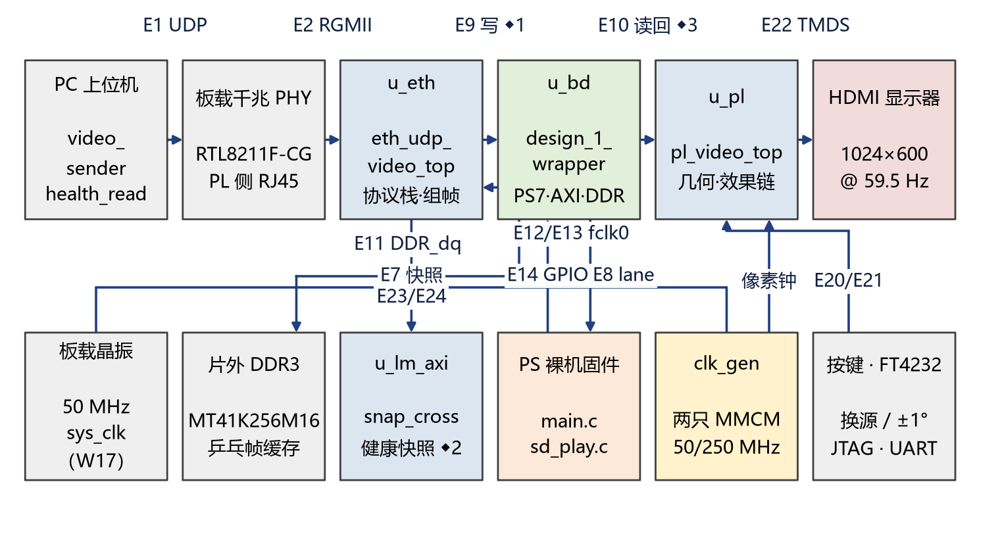
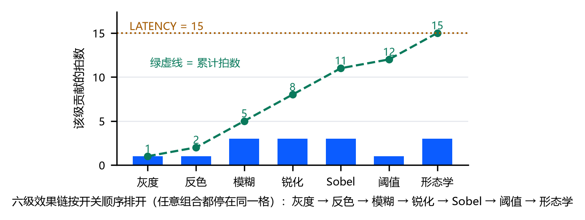

# Multi-Source Video Processing System

## An all-hardware video path and its instrumentation on Zynq-7020

## Abstract

The system implements a complete video path from a gigabit Ethernet port to an HDMI display on a single Zynq-7020. A host PC splits 512×300 RGB565 frames into UDP datagrams of at most 1392 bytes and sends them to port 5001. The PL receives them from RGMII, runs MAC, UDP filtering and offset-based reassembly, writes whole frames into a DDR ping-pong buffer, reads them back, applies scaling, arbitrary-angle rotation, bilinear interpolation and a six-stage effect chain, and drives a 1024×600, 59.5 Hz HDMI output with the OSD overlay and a ×2 expansion. Pixels never pass through the PS; the PS handles command parsing, status readback and SD playback.

The design treats one question as central: can a video node explain what it just did? A vertical seam puts the source frame and the processed version of the same frame side by side at pixel granularity. Both sides share the geometry engine and one effect chain fixed at 15 pixel clocks, so any geometry slip, missing column or out-of-range fill shows up on the seam. Every second the PL sends a 32-byte telemetry beacon over the network with frame count, packet count, bad packets, aborted frames, missing rows in the last abort, PL-internal latency and processed-pane integrity. A serial `link` command reports the latest, minimum, maximum and cumulative frame gap and can clear them. A three-stage host self-test injects packet loss and requires the readings to turn red and recover, which is what makes the instrumentation falsifiable rather than decorative.

The implemented design closes timing at WNS 1.341 ns and WHS 0.025 ns, with TNS and THS at zero and no failing endpoints; utilisation is LUT 28.13%, FF 8.55%, BRAM 70.00% and 19 DSPs. On the board, an 8-second stream delivers 241 frames, or 29.95 fps. The three-stage self-test reads 22.0 fps on a clean stream, 0 fps with 14.3 aborts per second under injected loss, and 18.9 fps after recovery, and passes. The QSPI image passed erase, program and hardware verify, and cold boot from a power cycle was confirmed; the new firmware's `link` command reads the frame-gap statistics directly.

**Keywords:** Zynq-7020; RGMII; UDP video; ping-pong buffer; bilinear interpolation; same-frame comparison; observability; timing closure

---

## 1 Background and goals

### 1.1 Where this is used

A remote video node usually gets one cable. There is no PC on site and no capture hardware. The operator needs three things at once: whether the picture arrived, whether processing took effect, and how much latency the display adds. Most demonstrations report a frame rate and stop there, so a dropped frame cannot be attributed to the network, to a failed DDR write or to a stalled display.

Broadcast and security confidence monitoring, and industrial-vision commissioning, ask the same questions. Before and after must come from the same frame at the same geometric position; otherwise "the algorithm did nothing" and "the link dropped a frame" look identical. Teaching needs a project that can be rerun end to end, where students can turn a check red themselves instead of trusting a conclusion.

### 1.2 Three engineering questions

**Did the frame arrive whole?** UDP does not retransmit, and one lost packet can invalidate a frame. Watching the screen only shows "it stutters sometimes"; it does not say which layer failed.

**Are the processed and source panes the same frame at the same position?** Once rotation and scaling enter, the two halves can easily compute different coordinates, and a visible difference may come from the algorithm or from geometry.

**How much time passes between a completed frame and its first visible line?** That number decides whether the node suits remote monitoring or closed-loop control, and most demonstrations do not report it.

### 1.3 Goals and boundaries

- One 512×300 RGB565 network stream at 30 fps in; 1024×600 at 59.5 Hz out.
- Packet ingest, reassembly, buffering, geometry, effects, blending, OSD and TMDS encoding all inside the PL; no pixel through the PS.
- Three sources — Ethernet, SD card and a PL-drawn test card — with automatic fallback when the stream stalls or the card is removed.
- Eight zoom steps, arbitrary-angle rotation, bilinear interpolation and a six-stage effect chain whose latency does not depend on configuration.
- Same-frame comparison, 1 Hz network telemetry, serial status commands and a host self-test that can inject faults.
- Build, simulation, board bring-up and QSPI programming reproducible from scripts.

The design does not chase 1080p or multiple streams. This device has 140 BRAM tiles, and the full-frame buffer plus the rotation window already take 70%; moving to 1024×600 needs roughly four times the storage, beyond what the part offers. The boundary is stated rather than hidden behind a zoom switch.

### 1.4 Related work and differences

A great deal of work already exists on this board and this class of problem, and this design does not claim higher throughput or wider generality.

Alex Forencich's `verilog-ethernet` provides a mature RGMII/MAC/UDP stack with better throughput and generality. This design keeps its own stack because the commit point, the row-coverage check and the DDR write port are built specifically for "commit a whole frame only". Swapping the stack would mean changing four verified boundaries at once — RGMII, UDP filtering, reassembly and the AXI write — and the gain would not be MAC throughput.

Xilinx VDMA and video-processing IP provide a general AXI Video path and are a fast route to a 1080p platform. The goal here is not a general IP block but tying same-frame A/B, a fixed 15-beat effect chain and live telemetry together at 512×300/30 fps. A larger frame needs a different memory architecture, and the 70% BRAM boundary is explicit.

A PYNQ overlay puts Python and the PS in control and accelerates in the PL, which suits rapid experiments. Here the pixel path is entirely in the PL and the PS only issues commands and plays SD content, so the design does not depend on the PYNQ runtime and claims no PYNQ-specific credit. The two solve different problems.

A commercial video analyser measures latency, dropped frames and picture quality more accurately, but it is external equipment. This design puts frame count, bad packets, aborts, missing rows, latency, processed-pane integrity and frame gaps on the same cable and the same serial port. The cost is accuracy and range compared with a dedicated instrument; the benefit is that nothing extra is needed on site.

Academic FPGA video pipelines often target 1080p, full-frame DDR traffic and higher throughput. This design chooses a small frame, on-chip full-frame storage and fixed latency, putting observability and reproducibility ahead of throughput. Each trade-off is listed in `docs/limits.md`.

## 2 System overview

### 2.1 Composition



Five parts: the host PC, the on-board gigabit PHY, the PL Ethernet and display logic, the PS bare-metal firmware, and the HDMI panel. The host scales any video to 512×300 and splits it into UDP datagrams. The PHY is an RTL8211F-CG on the PL-side RJ45. The PL runs the protocol stack, frame reassembly, DDR buffering, geometry and effects. The PS writes control words and reads status over AXI GPIO, and writes frames into DDR during SD playback. The panel receives 1024×600 HDMI timing.

### 2.2 Data path


The receive side starts at RGMII. Four data bits and the control line are sampled with IDDR on the PHY-recovered clock and moved into the 125 MHz logic domain through an asynchronous FIFO. MAC, ARP, ICMP, UDP port filtering, offset-based reassembly and statistics all live in that domain. The reassembler emits a commit pulse only when every byte has arrived, every source row has been written and the frame carries no bad packet. After commit, 16-bit pixels are packed into 64-bit words and written into the DDR ping-pong buffer by the PL acting as an AXI HP0 master.

If a half-received frame is followed by more than 4 ms of silence, an idle timer discards it, so the tail of one frame cannot be joined to the head of the next. The timer uses a 12-bit prescaler and drives a single bit into the header-clear cone; the 4 ms counter never sits on the byte or row path.


The display side reads the whole frame back from DDR into a 64-bit-wide frame buffer, then runs a fixed-point inverse mapping to obtain source coordinates and bilinear weights. Scaling and rotation share the same coordinate engine. After interpolation the pixels enter the six-stage effect chain, and the processed result is selected per pixel against a four-display-line source tap at the seam. Five OSD rows are overlaid, and the result is expanded ×2 into HDMI.

### 2.3 Hardware/software split

| Function | Where | Why |
|---|---|---|
| RGMII sampling, MAC, ARP/ICMP, UDP filtering, reassembly | PL | real-time byte stream, cannot tolerate CPU scheduling or interrupt latency |
| DDR ping-pong write, display readback, scaling/rotation/interpolation, effects, seam, OSD, TMDS | PL | per-pixel work whose latency follows pipeline depth |
| Command parsing, status readback, SD file system, temperature sampling | PS bare metal | low-speed control plane that needs files and strings |
| Streaming, telemetry listening, dashboard, fault injection | PC | no need to add storage or a display to the board |

The pixel path therefore has a latency set by hardware stages, independent of software state, while the control plane stays on the PS with its own GPIO channels. The cost is that control words cross clock domains; the benefit is that the display chain never waits for a CPU.

### 2.4 Three sources and arbitration

Three sources share the mover: the UDP stream, a pre-converted SD frame sequence and the PL test card. `src_arb` decides which one owns the mover based on link activity, frame requests and card-removal events. When the link stalls or the card is pulled, arbitration falls back to a source that still works, so the screen never freezes on the last frame forever.

Ethernet and SD frames have their own DDR banks. The PL switches the display read port only after a complete commit pulse, so the screen never shows half of one frame and half of another. The test card never enters memory; the PL draws it on the fly from the same source coordinates.

## 3 Key techniques

### 3.1 All-PL Ethernet receive and reassembly

The hard part is not parsing; it is deciding when a frame may be committed. UDP does not retransmit, packets can arrive out of order, go missing or be duplicated. Committing on the received byte count alone would show half a new frame beside half an old one.

The reassembler keeps a row-coverage bitmap and a byte gate per frame. Each packet is written at its intra-frame offset and updates the bitmap. Commit requires three conditions at once: the full 307,200 bytes, all 300 source rows covered, and no bad packet in this frame. If any condition fails, the frame is dropped, the abort counter increments and the number of missing rows in that abort is recorded. That missing-row count is a cause, not a rate: it separates "the network lost a packet and killed the frame" from "the display side stalled".

The bench exercises this check with a mutation: with enough bytes but only 3/4 of the rows, a row counter that degrades to "increment on every word" makes the bench report `FAIL commit with full byte count but only 3/4 rows`. A check that can turn red is a check that really looks at row coverage.

ARP, ICMP and UDP share the transmit GMII. Requests are queued and only granted when the medium is genuinely idle, so one frame is never swapped mid-transmission. Even with the stream saturating the link, the board still answers ping: the control path is not starved by the data path.

### 3.2 Display and geometry

The geometry engine maps the 512×300 source onto the 1024×600 panel. Each display pixel is inverse-mapped once: display coordinates are multiplied back into source coordinates, yielding `sx, sy`, an out-of-range flag and bilinear weights. The zoom factor is Q8 fixed point across eight steps from 0.25× to 2.0×; the rotation angle covers 0–359° with one 360-entry Q8 sine table and one cosine table. Scaling and rotation share these operators, so the source and processed panes see the same geometry instead of computing two sets of coordinates.

Interpolation is bilinear. Each source pixel needs four neighbours, and the read port fetches them in step with the pixel clock. With `bilin_en=0` the datapath degrades bit-for-bit to nearest neighbour, which makes the cost of interpolation measurable. The read port is single-ported and returns a pair one pair late, so it costs two display lines compared with nearest neighbour; the top level cancels that delay in the coordinates.

When rotation is enabled, the controller pulls the zoom factor to the step where the rotated image just fits, so it cannot rotate off-screen. The manual step is remembered and restored as soon as rotation stops; 0° is exempt.

The seam draws a 2-pixel marker by default, using the same out-of-range test as the image, so its ends never leave the picture. The marker can be turned off, and should be for pixel measurements, because it would otherwise be mistaken for a vertical line.

### 3.3 Six-stage effect chain with fixed latency

Stage 0 is gamma, a lookup table read combinationally, costing no pipeline beat. Stages 1 to 5 are:

| Stage | Function | Beats | Notes |
|---|---|---:|---|
| 0 | gamma | 0 | LUTRAM lookup, bitwise bypass |
| 1 | grayscale / invert | 1 + 1 | two control bits, can be chained |
| 2 | box blur / sharpen | 3 | shared 3×3 window read |
| 3 | Sobel | 3 | edge strength |
| 4 | threshold | 1 | includes the inverted-decision bit |
| 5 | erode / dilate | 3 | mutually exclusive; both set means neither runs |

The nine control bits map one-to-one onto the algorithms: grayscale, invert, blur, sharpen, Sobel, threshold, inverted decision, erode, dilate. Whatever is enabled, the chain latency stays at 15 pixel clocks: 1 + 1 + 3 + 3 + 3 + 1 + 3 = 15. Bypass paths are delayed by the same number of stages, so the constant does not depend on configuration.



That constant is what makes the seam usable as an instrument. If latency moved with configuration, the two sides would carry a fixed offset and any observed difference could no longer be attributed to the algorithm or the geometry.

### 3.4 Same-frame comparison and OSD

The seam cuts the output of one geometry chain. The left half is the source, the right half is the same frame after the effect chain; both share the same coordinates and the same beat. The seam position can be set in display columns or in image columns; the latter follows rotation and is the right choice for checking boundaries under rotation. The read port keeps a four-display-line tap for the source, and the 15-beat chain is aligned against that tap at the top level, so both sides of the seam are the same frame at the same position.


The OSD draws five rows: source size and frame rate, effect chain and threshold, rotation and zoom, seam position and PL-internal latency, temperature. Row 0 shows 512×300 because those parameters describe the source, not the panel. Drawing the OSD changes neither the seam geometry nor the processed-pane count.

### 3.5 Observability: telemetry, serial and frame gaps

Three outlets read the same counters.

**Network telemetry.** Once per second the PL sends a 32-byte beacon from UDP 1234 to the last ARP requester: frame count, packet count, bad packets, aborted frames, missing rows in the last abort, free-running seconds, PL-internal latency, source port and the processed-pane integrity count. It goes through neither the PS nor a serial port.

**Serial status.** The PS firmware offers `stat`, `temp`, `link`, `sd`, `play`, `src`, `pipe`, `zoom`, `rot`, `split`, `gamma` and `osd`. `link` reports the frame-gap statistics: `stall` is the live millisecond count since the last frame; `gap_last` is the most recent complete gap; `gap_min` and `gap_max` are the extremes since the last clear; `gap_sum` is the cumulative gap; `gap_valid` says the statistics have been calibrated by at least two frames. `link clr` clears `gap_*` but not `stall`. `gap_last` and `gap_max` update when a frame completes, so a stalled link grows `stall`, and the long gap is written only when the next frame arrives. Gaps are counted in milliseconds and saturate at `0xFFFF` instead of wrapping, so a maximum is never polluted by a wrap.

**AXI GPIO health snapshot.** Over JTAG the host selects a lane and reads link counters, zoom state, latency snapshots and arbitration inputs. The `health_read` tool reads all ten lanes twice and requires monotonic counters not to decrease on the second pass, which catches tearing during a snapshot refresh.

Telemetry and serial read the same PL counters. Telemetry suits long unattended observation, serial suits on-site step-by-step checks, GPIO suits reading one definite value once the stream has stopped. The three cross-check each other; when two disagree, the answer is in the RTL.

The processed-pane count is valid only when grayscale is the only stage enabled and the seam scans in image columns. Every pixel on the processed side should then be gray, and any non-gray pixel means the source leaked in or a bypass fired. The counter works per frame in the pixel domain, crosses domains as a snapshot, and the beacon carries a count saturated at 255 plus a valid bit.

The host three-stage self-test turns the readings into an executable check. A clean stream must hold at least 8 fps, at most the single boot-time abort, and at least one valid latency no greater than 200 ms. The fault stage drops one packet in 100 and requires at least 5 aborts per second with the frame rate below 5 fps. Recovery must return to the clean level. The check compares per-second deltas, never absolute values, and it can turn the instrument red in front of an audience and then let it recover.

## 4 Timing and resource optimisation

### 4.1 Clock domains

| Domain | Frequency | Use |
|---|---:|---|
| `sys_clk` | 50 MHz | board clock input (20 ns constraint), feeds the MMCM and the PS reference |
| `clkout0_1` | 50 MHz | pixel clock: display, geometry, effect chain |
| `clkout3` | 125 MHz | Ethernet protocol logic |
| `eth_rxc` | 125 MHz | PHY-recovered clock, only IDDR sampling and the async-FIFO write side |
| `clk_fpga_0` | 100 MHz | PS FCLK0: AXI control and DDR write side |

Protocol logic runs on the MMCM's 125 MHz, the display on 50 MHz and the control plane on the 100 MHz AXI clock. Pixel and serialiser clocks come from the same MMCM at a fixed 5:1 ratio; the Ethernet logic clock comes from the other MMCM.

Crossings fall into three classes: byte streams through a gray-code-pointer asynchronous FIFO; slow variables such as frame commit, latency and processed-pane counts through a snapshot that holds a whole beat in the source domain and samples it on a synchronised toggle edge in the destination; single-bit levels and resets through three-stage synchronisers, with reset asserted asynchronously and released synchronously in each domain.

The processed-pane bus is quasi-static: the source side updates it for a whole beat and the destination samples only after the synchronised toggle. It is not closed against a 4 ns setup derived from two independent MMCMs; instead `set_max_delay -datapath_only 10 ns` bounds the bit-to-bit skew. That constraint writes the design intent — the bus holds for at least one frame — into the timing report, and explains why the 1.029 ns processed-pane path from before the optimisation no longer appears.

### 4.2 Method and results

Optimisation followed structure first, constraints second, placement last. Each round changed one class of thing and compared against the same regression and the same timing reports, so placement noise could not be mistaken for a logic gain.

| Item | Change | Result | Cost |
|---|---|---|---|
| Clock-domain restructuring | protocol logic leaves the recovered clock; only sampling and FIFO write stay on it | the 1.029 ns processed-pane path goes away | crossing FIFO and synchronisers |
| Quasi-static crossing contract | 10 ns bit-skew constraint on the processed-pane bus | 8.7 ns margin there; the worst path returns to a real synchroniser | no extra logic |
| Arbiter `owner_eth` fan-out | `max_fanout` on the slow variable, replicated by synthesis | AXI domain 1.201 → 2.159 ns | 8 flip-flops |
| 125 MHz counters and checksums | `stat_bad` enable registered into one bit; ICMP checksum split across beats | Ethernet logic domain 1.245 → 1.727 ns | a few LUTs and FFs |
| UDP transmit checksum | 10-term add split into four beats: 5 + 5 + fold + fold | global WNS to 1.341 ns | 38 LUTs, 12 FFs |
| Local reset-tree replication | replicate the link-monitor local reset tree | WNS 1.104 → 1.172 ns | local flip-flops |

Final readings: WNS 1.341 ns, WHS 0.025 ns, TNS and THS zero, no failing endpoints. The worst path is reset recovery, `phy_rst_cnt_reg[23] → rst_lm_sync2_reg/CLR`, not a data path. The worst hold is in the pixel domain, `u_blur/dout_reg[15] → u_sharp/q22_reg[15]`, with 0.025 ns of margin — still positive.


| Domain | Period | WNS | WHS |
|---|---:|---:|---:|
| `sys_clk` | 20 ns | 14.797 ns | 0.067 ns |
| `clkout0_1` | 20 ns | 3.264 ns | 0.025 ns |
| `eth_rxc` | 8 ns | 3.247 ns | 0.071 ns |
| `clk_fpga_0` | 10 ns | 2.159 ns | 0.060 ns |
| `clkout3` | 8 ns | 1.727 ns | 0.068 ns |

### 4.3 Reset tree and checksum splitting

The reset tree is the most easily ignored timing debt here. `rst_l_sync2` drives 3002 asynchronous clear pins and needs 5.4 ns of routing after placement. `max_fanout` on that register did not trigger replication. Routing the reset through a BUFG dropped WNS from 1.104 to 1.078 ns and was withdrawn. Replicating only the link-monitor's local reset tree raised WNS from 1.104 to 1.172 ns and was kept. Moving the worst path off reset recovery would mean converting several protocol blocks to synchronous reset, which changes reset semantics and requires rerunning the ARP/ICMP benches and the full regression; that is not done here.

The IPv4 header checksum in UDP transmit is the other example. Ten terms in one beat were functionally correct but became the global worst path: six CARRY4 levels, 2.921 ns of logic and 3.565 ns of routing. Splitting it across four beats was re-verified by `tb_udp_telemetry`, `tb_eth_top_rgmii`, `tb_rows` and `tb_udp_reasm`, at a cost of 38 LUTs and 12 flip-flops. After the split the worst path returned to reset recovery, and further splitting has no payoff.

### 4.4 Where the resources go

| Resource | Used | Share | Main use |
|---|---:|---:|---|
| LUT | 14,967 | 28.13% | protocol stack, geometry, effects, OSD |
| FF | 9,095 | 8.55% | pipelines, counters, synchronisers |
| BRAM | 98 tiles | 70.00% | full-frame buffer for rotation and bilinear |
| DSP48 | 19 | 8.64% | coordinate mapping, interpolation, windows |

Of the 98 BRAM tiles, about 80 hold the full-frame display buffer required by rotation and bilinear interpolation, 1.5 form the two-row seam ring, about 10 are the DDR write FIFO, and the rest are effect and OSD line buffers. The 70% is therefore not scattered waste but the cost of storing a whole frame for rotation and interpolation. Reducing it significantly means changing how the geometry engine stores data — DDR line buffers or tiling — which is architectural work that does not pay off at this frame size and on this part.

DSP use is equally concentrated: `u_lerp` 6, `u_blur` 1, `u_split_ctrl` 1, `u_zfit` 3, `u_zmap` 8. Gamma is a LUTRAM table and uses none.

### 4.5 Physical boundary

The RGMII TskewT specification is ±0.5 ns. Every RGMII pin on this board sits in an HR bank without ODELAYE2, and 0° forwarding still leaves about 0.845 ns of hold margin missing. A 90° phase broke the link outright; −45° reduced the gap to 0.366 ns but dropped ping to 1 in 6, and both were withdrawn. Production forwards at 0° with the clock through ODDR, and long ping runs stay clean. The gap follows from the pinout and the bank type; no RTL edit removes it. The report calls it a boundary, not a solved item.

## 5 Verification and results

### 5.1 Strategy

Four layers:

1. Unit benches: CRC, UDP parsing, reassembly bounds, zoom mapping, bilinear, effect stages, OSD, CDC, arbitration.
2. Integration benches: the full RGMII-to-AXI ingest chain and the full DDR-to-TMDS display chain.
3. A full-video bench that runs rotation, eight zoom steps, bilinear, six effect stages, the seam, the OSD and boundary cases together.
4. Board acceptance: JTAG/QSPI boot, serial commands, network streaming, telemetry, fault injection, continuous streaming and temperature.

Each layer produces verdict lines that can be rechecked; "it looks normal" is never a conclusion.

### 5.2 Simulation

The standard regression has 19 benches (17 existing plus `eth_ingress_integrity` and `saver_tail_full`), covering Ethernet, display, geometry, effects and CDC. The delivered regression reads `fail=0`, and the full-video bench passes the 185° split, C17 processed-pane integrity and the C25/C26 frame-boundary specials.

Two cross-colour defects on a single row were closed with dedicated checks. C22 tests whether the effect chain's window stages see row tags and data in the same beat: before the fix, 6 and 48 fully white pixels appeared at the top and bottom edges; after, 0. C31 tags every cell with a 9-bit row label and checks which tap it selects: before the fix, two full rows at the frame tail had 1028 mismatching cells under rotation; after routing the seam `sx` through a two-row ring, the whole frame reads 0 in both swap states.

Frame-commit, UDP checksum, ICMP checksum, CDC snapshots and arbitration handover all have mutations that turn them red. The checks are themselves checked: a known-bad input must turn them red, and restoring the source must turn them green.

### 5.3 Board results

Acceptance ran on a Zynq-7020 development board. The PL-side RJ45 connects to the PC's wired NIC, board at 192.168.1.10 and PC at 192.168.1.100; serial is COM6 on the USB-C bridge at 115200 8N1; HDMI drives a 1024×600 panel.

| Item | Condition | Reading | Verdict |
|---|---|---|---|
| QSPI write/readback | erase, program, hardware verify | `PROGRAM_RC 0` | pass |
| Cold boot | power cycle | PL DONE=1, EOS=1, zero CRC/IDCODE errors; `stat`/`link` respond; ping 5/5 | pass |
| Continuous stream | 8 s of the built-in pattern at 30 fps | 241 frames / 8.05 s = 29.95 fps | pass |
| 1 Hz telemetry | listen 13 s after a ping | 13 beacons, frame count rising monotonically | pass |
| Three-stage self-test | clean → one packet in 100 dropped → clean | 22.0 fps; 0 fps with 14.3 aborts/s; 18.9 fps | pass |
| Processed-pane integrity | 185°, split video 50%, grayscale only | `pane_bad=0`, count valid | pass |
| Frame-gap statistics | `link clr`, stream, stop, restart | while streaming `gap_last=28 ms`, `gap_max=49 ms`, `gap_valid=1`; `stall` grows after stop; `gap_max=22,061 ms` after restart | pass |
| Serial commands | 105-command list | every command answers as expected, final state equals initial | pass |
| Temperature | continuous streaming | 61.8–63.8 °C, `sane=1` | pass |
| HDMI picture | human eye, continuous run | same frame left/right, matching geometry, OSD agrees with serial; days of running without tearing, flashing or frozen frames; recovery after ETH/SD hot-plug | E1–E5 confirmed; panel colour remains subjective |

The latency reading is PL-internal: from frame commit to the start of scan, including blanking wait and the DDR transfer, excluding encoding, cable and switch. It is not glass-to-glass, and the report says so.

### 5.4 Resources, timing and power

| Metric | Reading |
|---|---|
| Device | `xc7z020clg484-2` |
| Toolchain | Vivado / Vitis 2025.2.1 |
| Global WNS / WHS | 1.341 ns / 0.025 ns |
| TNS / THS | 0 / 0 |
| Failing endpoints | 0 / 56,043 |
| LUT / FF | 14,967 (28.13%) / 9,095 (8.55%) |
| BRAM / DSP | 98 tiles (70.00%) / 19 (8.64%) |
| Dynamic power | 2.228 W (tool estimate, 2.406 W total) |
| Junction temperature | 52.8 °C (tool estimate) |

Power and junction temperature come from the Vivado estimate without a simulation activity file, so confidence is low. The on-board reading comes from the XADC and runs 61.8–63.8 °C. The two must not be conflated.

### 5.5 Discussion

The strength is that everything can be checked. Frame rate, aborts, missing rows, latency, processed-pane integrity and frame gaps all have hardware counters, and telemetry, serial and GPIO read the same numbers. The seam provides a pixel-level visual reference, and fault injection proves the instrument can turn red. The weaknesses are equally clear: BRAM is at 70% and the frame cannot grow; the RGMII transmit side has a physical hold gap; latency covers the PL only; HDMI E1–E5 are confirmed on the bench, while panel colour remains subjective.

## 6 Engineering and reproduction

### 6.1 Layout

```text
README.md             project overview and entry point
src/                  RTL, PS firmware, constraints, host tools
sim/                  unit, integration and full-video benches
scripts/              build entry, Vitis/PS/sim scripts
hw/                   Vivado/Vitis projects, board scripts, reports and measurements
data/                 test inputs, golden images, metrics table
docs/                 design, verification, optimisation, commands, interface, limits
```

The Vivado project in `hw/vivado/` is generated by `scripts/build.tcl` and staged with relative paths: no missing sources or constraints, and no local absolute paths in the project files. The Vitis platform descriptor is in `hw/vitis/`; FSBL and platform rebuild with `scripts/vitis/rebuild_vitis.py`. The PS application is compiled by `scripts/ps/build_ps_app.py` without touching the IDE.

### 6.2 Build

```bash
vivado -mode batch -source scripts/build.tcl
```

This creates the project and block design, runs synthesis and implementation, writes the bitstream, XSA and the timing, resource, CDC and power reports. Add `-tclargs bd_only` to stop after the project and block design.

PS application:

```bash
PS_CC=<Vitis>/gnu/aarch32/nt/gcc-arm-none-eabi/bin/arm-none-eabi-gcc.exe \
PS_BSP=<BSP from the platform build> \
PS_OUT=hw/project/ps_app.elf \
python scripts/ps/build_ps_app.py
```

### 6.3 Simulation

```bash
bash scripts/sim/run_msim.sh rows udp_reasm reasm_bounds udp_telemetry \
     eth_ctrl_arb eth_top_rgmii split_ctrl osd_overlay link_monitor
```

Verdict lines for the full-video and special benches are in `sim/README.md` and `hw/reports/`. Read the `RESULT` lines, not "did anything print an error".

### 6.4 Board

```bash
VP_XSDB=<Vitis>/bin/xsdb.bat VP_VIVADO_BIN=<Vivado>/bin \
  bash hw/scripts/board_flash.sh
python src/host/video_sender.py --demo --seconds 8
python src/host/telemetry_listen.py 13
python src/host/link_selftest.py 192.168.1.10 6
```

QSPI:

```bash
VP_VIVADO_BIN=<Vitis>/bin bash hw/scripts/make_boot_image.sh
VP_HW_URL=<host:port> vivado -mode batch -source hw/tcl/flash_qspi.tcl
```

Power-cycle after writing, watch the boot messages on the serial port, then run `stat`, `link` and the telemetry listener. A JTAG download is volatile; the QSPI image is the deliverable that boots without a host.

### 6.5 Identity of the deliverables

Bitstream, XSA and firmware live in `hw/project/` and are identified by MD5, not by file name. The Vivado project, Vitis platform descriptor, host tools and benches are all in the repository, so every number in this report can be traced back to an implementation report or a board log.

## 7 What the design contributes

### 7.1 Turning the comparison into an instrument

The seam is not a filter effect. It is a per-pixel comparison of the same frame at the same coordinates, which turns "did processing happen, is the geometry right" from a judgement call into something that can be checked column by column. Both halves share the geometry engine and the 15-beat chain, so a difference on the seam can only come from the algorithm or the geometry, never from two independent scalers.

### 7.2 An instrument that can be made to fail

Telemetry carries aborted frames and the missing rows of the last abort, which answers "why did it drop" rather than only "how many". The processed-pane count answers whether the source leaked into the processed side. The three-stage self-test switches between a clean stream, deterministic loss and recovery, and requires aborts to rise and the frame rate to fall in the fault stage. If the instrument did not react to deliberate damage, the whole observation scheme would be worthless.

### 7.3 All-hardware path and fixed latency

Pixels never touch the PS: ingest, reassembly, buffering, geometry, effects, blending, OSD and TMDS encoding all run in the PL. Effect-chain latency does not move with configuration, and every display stage has a latency set by its hardware depth. For remote monitoring and closed-loop control, that is worth more than two extra filters.

### 7.4 A reproducible package

Build, simulation, board bring-up, QSPI programming and Vitis platform rebuild all have scripts. The Vivado project is staged with relative paths in `hw/vivado/` and was opened and checked; benches print verdicts; board readings are logged. The package is not "a pile of sources that compiles" but a path someone else can run from zero to a lit screen.

## 8 Limits and further work

**RGMII transmit side.** The HR bank has no ODELAYE2, and 0° forwarding still leaves about 0.845 ns of TskewT hold margin missing. Both the 90° and −45° compensation routes were rejected on the board. The current scheme pings cleanly for long runs, but the gap is a physical boundary, not a solved item.

**BRAM and frame size.** About 80 of the 98 BRAM tiles are the full-frame buffer for rotation and bilinear interpolation, 70% of the part. Moving to 1024×600 needs roughly four times the storage and does not fit. Cutting BRAM means changing how the geometry engine stores frames — architectural work.

**Latency definition.** Telemetry latency covers the PL only, from frame commit to the start of scan, excluding encoding, cable and switch. It is not glass-to-glass.

**Human-eye checks.** The 185° thin-line case is closed in RTL and on the bench, and the processed-pane count is 0. E1–E5 (same frame left/right, matching geometry, OSD readings, days of continuous running, ETH/SD hot-plug recovery) were confirmed on site with nothing abnormal. Cable quality and panel colour remain subjective.

**Reset semantics.** The worst path is still reset recovery. Converting the large asynchronous resets to synchronous resets would push WNS further but changes reset semantics and requires rerunning the ARP/ICMP benches and the full regression. It is not done.

**Porting.** The IDELAY, BUFIO and ODDR usages are tied to 7-series devices, and the AXI GPIO control plane is tied to the current PS configuration. Moving to UltraScale+ or another board requires re-verifying these items rather than copying them.

## 9 Conclusion

The system ties a complete hardware video path to an observation scheme that can be shown to fail. It outputs 1024×600 at 59.5 Hz from a 512×300/30 fps source, keeps the effect-chain latency at 15 pixel clocks, provides a pixel-level same-frame comparison, and reports frame count, bad packets, aborts, missing rows, latency, processed-pane integrity and frame gaps over telemetry and a serial port. The three-stage self-test proves the instrument turns red; the QSPI image passed program and verify, and cold boot from a power cycle was confirmed.

The value is not in the number of effects. It is that every claim has a reading, every reading has an outlet, and every outlet can be cross-checked. That is harder to argue with than two more filters, and easier to explain on site.

## Appendix A Key interfaces

### A.1 Control word

| Bits | Meaning |
|---|---|
| 8:0 | nine effect-chain bits: grayscale, invert, blur, sharpen, Sobel, threshold, inverted decision, erode, dilate |
| 18:9 | geometry: seam position, auto/follow/swap/marker, rot_auto, rot_speed, zoom_fit |
| 19 | bilinear enable |
| 20 | OSD enable |
| 26 | clear frame-gap statistics |

### A.2 Telemetry fields

| Offset | Length | Meaning |
|---:|---:|---|
| 0 | 4 | magic `VDEO` |
| 4 | 1 | version |
| 5 | 1 | bit0 link alive |
| 6 | 4 | frames received |
| 10 | 4 | packets received |
| 14 | 4 | bad packets |
| 18 | 2 | missing rows in the last abort |
| 20 | 4 | free-running seconds |
| 24 | 2 | aborted frames |
| 26 | 2 | PL-internal latency (ms) |
| 28 | 2 | source port |
| 30 | 1 | bit0 latency valid, bit1 processed-pane count valid |
| 31 | 1 | non-gray pixels in the processed pane (saturates at 255) |

### A.3 Serial commands

| Command | Purpose |
|---|---|
| `stat` | print control state, frame counts, effect selection, geometry words |
| `temp` | print XADC temperature, VCCINT, OSD encoding and GPIO readback |
| `link` / `link clr` | read / clear frame-gap statistics |
| `src auto\|0\|1\|2` | source: auto, test card, network, SD |
| `pipe <nine bits>` / `pipe show` | set / show the effect chain |
| `zoom on\|off\|auto\|<ratio>` | zoom switch, automatic, manual ratio |
| `rot auto\|0\|1` / `rot speed 0..7` | automatic rotation / degrees per frame |
| `split screen\|video <0..100>` / `split swap` | seam mode, position, pane swap |
| `gamma <1.00..3.00>\|off\|auto` | gamma curve |
| `osd on\|off` | OSD |
| `sd files` / `sd file n` / `play` / `stop` | SD selection and playback |

## Appendix B Where the evidence lives

| Item | Location |
|---|---|
| Design sources | `src/rtl/`, `src/ps/`, `src/constraints/` |
| Host tools | `src/host/` |
| Benches | `sim/`, verdicts in `sim/README.md` |
| Implementation reports | `hw/reports/` |
| Board readings | `hw/measured/` |
| Design report and figures | `docs/design-report.md`, `docs/figures/` |
| Verification and optimisation | `docs/verification.md`, `docs/optimization.md` |
| Defect ledger | `docs/issues/key-issues.md` |
| Interface tables | `docs/interface-table.md` |
| Reproduction | `docs/reproduction.md` |
| Limits | `docs/limits.md` |
