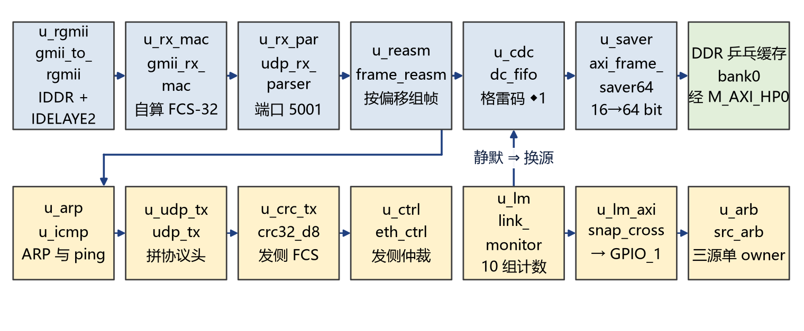
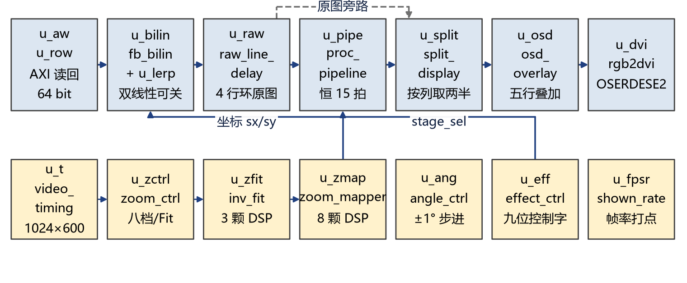
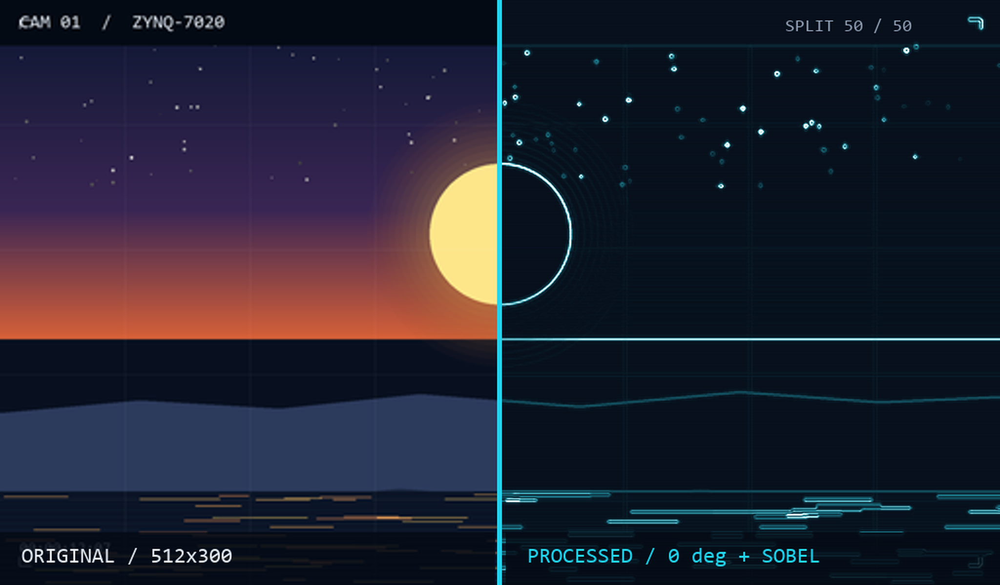
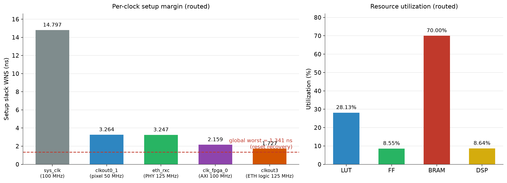

# 多源视频流多效果变换处理系统

## 基于 Zynq-7020 的全硬件视频通路与可观测性设计

## 摘要

系统在一颗 Zynq-7020 上实现了一条从千兆网口到 HDMI 显示器的全硬件视频通路。上位机把 512×300、RGB565 的帧切成不超过 1392 字节的 UDP 报文发到 5001 端口；PL 从 RGMII 开始收包，经 MAC、UDP 过滤和按帧内偏移重组后写入 DDR 乒乓缓存，再由显示侧读回，做缩放、任意角度旋转、双线性插值和六级效果处理，最后与 OSD 一起按 ×2 展开成 1024×600、59.5 Hz 的 HDMI 输出。像素通路不经过 PS，PS 只负责命令解析、状态回读和 SD 卡回放。

设计把“视频节点能不能说清楚自己刚刚做了什么”作为核心问题。屏幕中间的竖缝把同一帧的原图与处理图按像素并排，两侧共用几何算子和同一条固定 15 个像素时钟的效果链，任何几何错位、少列或越界填黑都会直接出现在缝上。PL 每秒从网口回一包 32 字节遥测，报告帧数、包数、坏包、作废帧、最后一次作废缺行数、PL 内部时延和处理窗完整性；串口另有 `link` 命令读出帧间隔的最近值、最小值、最大值和累计值，并支持清零。主机侧的三阶段自检会人为注入丢包，要求读数变红再恢复，使这套观测成为可被证伪的仪表，而不是装饰。

实现后的静态时序为 WNS 1.341 ns、WHS 0.025 ns，TNS 与 THS 均为 0，失败端点 0；资源为 LUT 28.13%、FF 8.55%、BRAM 70.00%、DSP 19 颗。板上连续推流 8 秒收到 241 帧，折合 30.01 fps；三阶段自检在干净流、注入丢包和恢复流下分别读到 19.0 fps、0 fps 且 13.0 次作废每秒、22.2 fps，判定通过。QSPI 镜像经过擦除、写入和硬件回读校验；断电冷启动在交付前复验。

**关键词**：Zynq-7020；RGMII；UDP 视频；乒乓缓存；双线性插值；同帧对照；可观测性；时序收敛

---

## 1 选题背景与设计目标

### 1.1 应用背景

远程视频节点通常只有一根网线，现场没有 PC，也没有额外的采集设备。操作者需要同时知道三件事：画面有没有收到、处理有没有生效、显示延迟是多少。传统演示往往只报一个帧率，遇到掉帧时无法区分是网络丢包、DDR 写入失败，还是显示侧卡住。

广播与安防的置信度监测、工业视觉的调试与验收也有同样的需求。处理前后的画面必须来自同一帧、同一个几何位置，否则“算法没生效”和“链路丢帧”会被混为一谈。教学场景则需要一条能整条重跑的工程，学生可以自己把判据跑红，而不是只相信结论。

### 1.2 三个工程问题

设计围绕三个问题展开。

第一，帧到底收全了没有。UDP 不重传，丢一个包就可能让整帧作废；只看屏幕，看到的是“偶尔卡一下”，说不清问题在哪一层。

第二，处理图与原图是不是同一帧、同一个几何位置。旋转和缩放一旦引入，左右两半很容易各算各的坐标，屏幕上的差异可能来自算法，也可能来自几何错位。

第三，从收完一帧到它开始上屏，中间压了多少时间。这个数决定系统能否用于远程监看或闭环控制，但多数演示不报告它。

### 1.3 设计目标与边界

设计目标如下：

- 单路 512×300、RGB565、30 fps 网络视频输入，输出 1024×600、59.5 Hz HDMI；
- 收包、拼帧、缓存、几何、效果、混合、OSD 和 TMDS 编码全部在 PL 内完成，像素不经过 PS；
- 支持以太网、SD 卡和 PL 测试图卡三路片源，断流或拔卡时自动回落；
- 缩放八档、旋转任意角度、双线性插值、六级效果链，链路延迟不随配置变化；
- 同帧左右对照、1 Hz 网络遥测、串口状态命令、可注入故障的主机自检；
- 构建、仿真、上板和 QSPI 固化均可由脚本复现。

设计不追求 1080p 或多路视频。当前器件有 140 个 BRAM tile，整帧缓存和旋转窗口已经占去 70%，把画幅提高到 1024×600 需要约四倍存储，超出该器件的可用范围。这个边界在设计中明确保留，不用缩放开关伪装成更高画幅。


## 2 系统总体方案

### 2.1 系统组成


系统由五部分组成：PC 上位机、板载千兆 PHY、PL 以太网与显示逻辑、PS 裸机固件、HDMI 显示器。上位机把任意视频缩放到 512×300 并切成 UDP 报文；板载 PHY 使用 RTL8211F-CG，接在 PL 侧 RJ45 上；PL 完成协议栈、帧重组、DDR 缓存、几何与效果处理；PS 通过 AXI GPIO 写控制字、读状态，并在 SD 回放时把帧写进 DDR；显示器接收 1024×600 的 HDMI 时序。

### 2.2 数据通路



接收侧从 RGMII 开始。四个数据位和控制位先用 IDDR 在 PHY 恢复时钟上采样，再通过异步 FIFO 搬到 125 MHz 的逻辑时钟域。MAC、ARP、ICMP、UDP 端口过滤、按帧内偏移重组和统计都在这个时钟域完成。重组器只有在整帧字节数到齐、所有源行都被覆盖、且本帧没有坏包时才发出提交脉冲；提交之后，16 位像素被打包成 64 位字，由 PL 作为 AXI HP0 主设备写入 DDR 乒乓缓存。



显示侧从 DDR 读回整帧，先写进 64 位宽的帧缓存，再做定点逆映射，得到源坐标和双线性权重。缩放和旋转共用同一组坐标算子；插值之后进入六级效果链，处理结果与一条 4 显示行的原图抽头在竖缝处逐像素二选一，最后叠五行 OSD，按 ×2 展开送到 HDMI。

### 2.3 软硬件划分

| 功能 | 放在哪里 | 理由 |
|---|---|---|
| RGMII 采样、MAC、ARP/ICMP、UDP 过滤、帧重组 | PL | 实时字节流，不能受 CPU 调度和中断延迟影响 |
| DDR 乒乓写、显示读回、缩放/旋转/插值、效果链、竖缝、OSD、TMDS | PL | 逐像素处理，延迟由流水线级数决定 |
| 命令解析、状态回读、SD 文件系统、温度采样 | PS 裸机 | 低速控制面，需要文件和字符串处理 |
| 推流、遥测监听、仪表、故障注入 | PC | 现场不需要在板上增加存储和显示 |

这样划分的结果是：像素通路每一级的延迟由硬件级数决定，与软件运行状态无关；控制面留在 PS，命令和状态各走独立的 GPIO 通道。代价是控制字要跨时钟域，收益是显示链不受 CPU 调度影响。

### 2.4 三路片源与仲裁

片源有三路：网口 UDP 视频、SD 卡预转换帧序列、PL 自绘测试图卡。`src_arb` 根据链路活跃度、帧请求和拔卡事件决定哪一路拿到搬运引擎。链路静默或拔卡时，仲裁自动回落到还在工作的一路，屏幕不会永久冻在最后一帧。

ETH 和 SD 的帧各有自己的 DDR bank。PL 只在收到完整的帧提交脉冲之后才切换显示读口，因此屏幕上不会出现半新半旧的帧。图卡不进内存，由 PL 按同一份源坐标现场绘制。


## 3 关键技术与实现

### 3.1 全 PL 以太网接收与帧重组

以太网接收的难点不在协议解析，而在“什么时候可以提交一帧”。UDP 没有重传，包可能乱序、丢失或重复；如果按收到的字节数直接提交，屏幕上会出现半帧新、半帧旧。

重组器为每一帧维护一张行覆盖位图和一个字节门。每个包按帧内偏移写入对应的行，写完更新覆盖位图；只有同时满足三个条件才提交：整帧字节数达到 307200、所有 300 行都被覆盖、本帧没有坏包。任何一个条件不满足，整帧作废，作废计数加一，并记录最后一次作废缺了多少行。这个“缺行数”是原因，不是速率：它能把“网络丢包毁掉整帧”和“显示侧卡住”区分开。

台架对这条判据做了变异对照：在字节数已经够、但只覆盖 3/4 行的激励下，如果行计数退化成“每写一个字加一”，台架会报 `FAIL commit with full byte count but only 3/4 rows`。判据能红，才说明它真的在看行覆盖。

发送侧由 ARP、ICMP 和 UDP 三路共用 GMII。请求先记账，等介质真正空闲才兑现，避免一帧发到一半被另一路换掉。推流占满带宽时，板子仍能 ping 通，控制通路不被数据通路拖死。

### 3.2 显示与几何引擎

几何引擎把 512×300 的源画面映射到 1024×600 的面板。每个显示像素先做一次逆映射：显示坐标乘回源坐标，得到 `sx, sy`、越界标志和双线性权重。缩放系数用 Q8 定点，八档覆盖 0.25 到 2.0 倍；旋转角度为 0 到 359°，正弦和余弦各用一张 360 项的 Q8 查找表。缩放和旋转共用这组算子，所以原图和处理图看到的是同一个几何，不会各算一套坐标。

插值使用双线性。每个源像素需要四个邻点，读口按像素时钟的节拍把它们取齐；`bilin_en=0` 时逐位退化为最近邻，方便对照“插值本身带来了多少差异”。读口是单口的，一对结果要下一对才读得到，因此比最近邻多两显示行的延迟；这个延迟在顶层坐标里一起抵消。

旋转打开时，控制器把倍率收进“当前角度刚好装得下”的一档，避免转出画面。手动档号不会丢，关掉旋转后立刻恢复；0° 不受这条限制。

竖缝默认画一条 2 像素宽的标记线，位置与画面几何使用同一个越界判据，线的端点不会跑到画面外。标记线可以关闭，做像素测量时应当关闭，因为它本身会被误认成一条竖线。

### 3.3 六级效果链与恒定延迟

效果链的级 0 是 gamma。它是一张查找表，组合读出，不占流水拍。级 1 到 5 依次是：

| 级 | 功能 | 拍数 | 说明 |
|---|---|---:|---|
| 0 | gamma | 0 | LUTRAM 查表，逐位旁路 |
| 1 | 灰度 / 反色 | 1 + 1 | 两个控制位，可串联 |
| 2 | 箱式模糊 / 锐化 | 3 | 共用 3×3 窗口读法 |
| 3 | Sobel | 3 | 边缘强度 |
| 4 | 二值化 | 1 | 带判决反相位 |
| 5 | 腐蚀 / 膨胀 | 3 | 两位互斥，同时置位时都不做 |

九位控制字逐位对应一个算法：灰度、反色、模糊、锐化、Sobel、二值化、判决反相、腐蚀、膨胀。其中腐蚀与膨胀互斥，两位同时置位时两个都不做。无论打开哪些级、怎样串联，链路延迟都保持 15 个像素时钟：1 + 1 + 3 + 3 + 3 + 1 + 3 = 15。旁路路径按同样的级数延迟，因此这个常数与配置无关。


这个常数是竖缝能够作为量具的前提。如果延迟随配置变化，缝两侧就会出现固定错位，观测到的差异无法归因于算法或几何。

### 3.4 同帧对照与 OSD

竖缝切在同一条几何链的输出上。左半是原图，右半是同一帧经效果链处理后的结果；两侧共用同一组坐标、同一拍。缝的位置可以按屏幕列设置，也可以按画面列设置；后者会跟着旋转走，适合检查旋转状态下的边界。读口为原图保留了一条 4 显示行的抽头，处理链的 15 拍延迟与这条抽头在顶层对齐，所以竖缝两侧是同一帧、同一几何位置。



OSD 画五行：源画面尺寸与帧率、效果链与阈值、旋转与缩放、缝位与 PL 内部时延、温度。第一行显示 512×300，因为这些参数描述的是片源，不是面板。OSD 的绘制不改变竖缝的几何，也不参与处理窗完整性计数。

### 3.5 可观测性：遥测、串口与帧间隔统计

可观测性由三个出口组成，它们读的是同一组计数。

**网络遥测。** PL 每秒从 UDP 1234 向最后一个 ARP 请求方发一包 32 字节信标。字段包括：累计帧数、累计包数、坏包数、累计作废帧数、最后一次作废缺行数、自由运行秒计数、PL 内部时延、源端口和处理窗完整性计数。信标不经过 PS，也不需要串口或 JTAG。

**串口状态。** PS 固件提供 `stat`、`temp`、`link`、`sd`、`play`、`src`、`pipe`、`zoom`、`rot`、`split`、`gamma`、`osd` 等命令。其中 `link` 读出帧间隔统计：`gap_last` 是最近一帧间隔，`gap_min` 和 `gap_max` 是自上次清零以来的最小值和最大值，`gap_sum` 是累计间隔，`gap_valid` 表示统计已经由至少两帧校准；`link clr` 在读取之前把统计清零。帧间隔按毫秒计数，计数到 `0x1FFFF` 后饱和在 `0xFFFF`，不回卷，避免最大值被回卷污染。

**AXI GPIO 健康快照。** 主机可以通过 JTAG 选择 lane，读回链路计数、缩放状态、时延快照和仲裁输入。`health_read` 工具把 10 条 lane 读两遍，单调计数器只允许第二遍不小于第一遍，用来发现快照刷新时的撕裂。

网络遥测和串口读的是同一组 PL 计数器。遥测适合长时间、无连接观察；串口适合现场逐项排查；GPIO 适合在推流停止后读一个确定值。三个出口互为对照，任何一个数对不上，都能回到 RTL 里找原因。

处理窗完整性计数只在“只开灰度、并且竖缝按画面列扫描”时有效。此时处理侧的每个像素都应该是灰的，任何非灰像素都意味着处理侧漏进了原图或旁路。计数器在像素域按帧统计，经跨时钟域快照送到遥测，载荷给出饱和到 255 的计数和一个有效位。

主机侧的三阶段自检把上述读数变成可执行的判据。干净流要求帧率不低于 8 fps、作废帧最多一次启动作废、至少一次有效时延且不超过 200 ms；故障段每 100 包丢 1 包，要求作废帧至少 5 次每秒、帧率低于 5 fps；恢复段回到干净流水平。判据取每秒的变化量，而不是绝对值。这个自检可以在评委面前把仪表打红，再让它恢复。


## 4 时序与资源优化

### 4.1 时钟域划分

设计有四个主要时钟域：

| 时钟域 | 频率 | 用途 |
|---|---:|---|
| `sys_clk` | 100 MHz | 板载晶振输入，供 MMCM 和 PS 参考 |
| `clkout0_1` | 50 MHz | 像素时钟，显示、几何、效果链 |
| `clkout3` | 125 MHz | 以太网协议逻辑 |
| `eth_rxc` | 125 MHz | PHY 恢复时钟，只用于 IDDR 采样和异步 FIFO 写侧 |
| `clk_fpga_0` | 100 MHz | PS FCLK0，AXI 控制与 DDR 写侧 |

恢复时钟只用于 IDDR 采样和异步 FIFO 写侧。协议逻辑放在 MMCM 产生的 125 MHz，显示在 50 MHz，控制面是 100 MHz 的 AXI 时钟。像素时钟和串化时钟来自同一颗 MMCM，保持 5:1 的固定关系；ETH 逻辑时钟来自另一颗 MMCM。

跨域分三类处理：字节流用格雷码指针的异步 FIFO；帧提交、时延、处理窗计数这类慢变量用“源域整拍保持 + 目的域同步翻转沿再采样”的快照器；单 bit 电平和复位用三级同步器，复位异步断言、本域同步释放。

处理窗总线是准静态的：源域整拍更新，目的域等到同步后的翻转沿才采。它不按两颗独立 MMCM 之间的 4 ns setup 去收，而是用 `set_max_delay -datapath_only 10 ns` 约束位间 skew。这条约束把“总线至少保持一帧”的设计意图写进时序报告，也解释了为什么优化前那条 1.029 ns 的处理窗总线路径在优化后不再出现。

### 4.2 优化方法与结果

优化按“先动结构，再动约束，最后动布局”的顺序进行。每一轮只改一类东西，改完用同一份回归和同一套时序报告比较，避免把布局扰动当成逻辑收益。

| 优化项 | 做法 | 结果 | 代价 |
|---|---|---|---|
| 时钟域重构 | 协议逻辑离开恢复时钟，恢复时钟域只保留采样与 FIFO 写侧 | 处理窗总线路径从 1.029 ns 让开 | 跨域 FIFO 与同步器 |
| 准静态跨域契约 | 处理窗总线加 10 ns 位间 skew 约束 | 该路径余量 8.7 ns，最差路径回到真实同步路径 | 无额外逻辑 |
| 仲裁器 `owner_eth` 扇出 | 对慢变量加 `max_fanout`，综合复制寄存器副本 | AXI 域从 1.201 ns 提到 2.159 ns | 8 个触发器 |
| 125 MHz 计数与校验 | `stat_bad` 使能寄存成单 bit；ICMP 校验拆拍 | ETH 逻辑域从 1.245 ns 提到 1.727 ns | 少量 LUT/FF |
| UDP 发送校验和 | 10 项加法拆成 4 拍：5 + 5 + 折叠 + 折叠 | 全设计 WNS 提到 1.341 ns | 38 个 LUT、12 个触发器 |
| 复位树局部复制 | 复制 link-monitor 本地复位树 | WNS 从 1.104 ns 提到 1.172 ns | 局部触发器 |

最终实现后的读数是 WNS 1.341 ns、WHS 0.025 ns，TNS 和 THS 都为 0，失败端点 0。全设计最差路径是复位恢复路径 `phy_rst_cnt_reg[23] → rst_lm_sync2_reg/CLR`，不是数据路径；最差 hold 在像素域 `u_blur/dout_reg[15] → u_sharp/q22_reg[15]`，余量 0.025 ns，仍为正。



逐时钟余量如下：

| 时钟域 | 周期 | WNS | WHS |
|---|---:|---:|---:|
| `sys_clk` | 20 ns | 14.797 ns | 0.067 ns |
| `clkout0_1` | 20 ns | 3.264 ns | 0.025 ns |
| `eth_rxc` | 8 ns | 3.247 ns | 0.071 ns |
| `clk_fpga_0` | 10 ns | 2.159 ns | 0.060 ns |
| `clkout3` | 8 ns | 1.727 ns | 0.068 ns |

### 4.3 复位树与校验和拆分

复位树是这套设计里最容易被忽略的时序债。`rst_l_sync2` 驱动 3002 个异步清零端，布线后要走 5.4 ns。给这个寄存器加 `max_fanout` 没有触发复制；改用 BUFG 把复位送上全局网络，WNS 反而从 1.104 ns 降到 1.078 ns，已经撤回。后来只复制 link-monitor 的本地复位树，WNS 从 1.104 ns 提到 1.172 ns。要让全设计最差路径离开复位恢复，需要把协议模块里几个大块的异步复位改成同步复位，这会改变复位语义，必须重跑 ARP/ICMP 台架和全量回归，当前没有做。

UDP 发送的 IPv4 头校验和是另一个典型。10 项加法放在一拍内完成，功能正确，但成为全设计最差路径：6 级 CARRY4，logic 2.921 ns，route 3.565 ns。把它拆成四拍后，功能由 `tb_udp_telemetry`、`tb_eth_top_rgmii`、`tb_rows` 和 `tb_udp_reasm` 四支台架复验，代价是 38 个 LUT 和 12 个触发器。拆完以后，最差路径回到复位恢复，继续拆校验和已经没有收益。

### 4.4 资源去向

实现后的资源占用为：

| 资源 | 用量 | 占比 | 主要去向 |
|---|---:|---:|---|
| LUT | 14 967 | 28.13% | 协议栈、几何、效果链、OSD |
| FF | 9 095 | 8.55% | 流水线、计数器、同步器 |
| BRAM | 98 tile | 70.00% | 旋转与双线性的整帧缓存 |
| DSP48 | 19 | 8.64% | 坐标映射、插值、窗口运算 |

98 个 BRAM 里，约 80 个是旋转与双线性需要的整帧显示缓存，1.5 个是竖缝 `sx` 的 2 行环，以太网侧约 10 个主要是 DDR 写方向的异步 FIFO，其余是效果链和 OSD 的行缓存。这个分布说明 70% 不是零散浪费，而是旋转和双线性需要的整帧存储。要把这一项显著降下来，只能改几何引擎的存储方案，例如把整帧缓存换成 DDR 行缓存或分块处理；这属于架构级改动，在当前画幅和器件上不划算。

DSP 的使用也集中在坐标与窗口运算：`u_lerp` 6 颗、`u_blur` 1 颗、`u_split_ctrl` 1 颗、`u_zfit` 3 颗、`u_zmap` 8 颗。gamma 是 LUTRAM 查表，不使用 DSP。

### 4.5 物理边界

RGMII 的 TskewT 规格是 ±0.5 ns。本板的 RGMII 引脚都在 HR bank，没有 ODELAYE2，0° 转发时实测仍有约 0.845 ns 的保持余量缺口。试过 90° 相位和 −45° 补偿：前者直接把链路打断，后者把缺口减到 0.366 ns，但板上 ping 只剩 1/6，已经撤回。当前生产位流使用 0°、时钟也过 ODDR 的方案，板上长时间 ping 稳定。这个缺口由 pinout 和 bank 类型决定，不是再调几行 RTL 能消掉的；报告把它写成边界，不写成“已解决”。


## 5 验证与结果

### 5.1 验证策略

验证分四层：

1. 单元台架：CRC、UDP 解析、重组边界、缩放映射、双线性、效果链、OSD、CDC、仲裁等；
2. 集成台架：从 RGMII 到 AXI 的完整入包链，从 DDR 到 TMDS 的完整显示链；
3. 完整视频台架：旋转、八档缩放、双线性、六级效果、竖缝、OSD 和边界条件一起跑；
4. 板级验收：JTAG/QSPI 启动、串口命令、网络推流、遥测、故障注入、连续流和温度。

每一层都给出可复核的判定行，不用“看起来正常”代替结论。

### 5.2 仿真结果

标准回归共 17 支，覆盖以太网、显示、几何、效果和 CDC；另有 `eth_ingress_integrity` 与 `saver_tail_full` 两支专项台架。交付版本的回归结果为 `fail=0`；完整视频台架的 185° 分割、C17 处理窗完整性、C25/C26 帧边界专项均 PASS。

显示侧的两条一行串色由专项判据闭合。C22 针对效果链窗口级的行标签与内容是否同拍：优化前帧顶/帧底各 6/48 个满白像素，优化后为 0。C31 用 9 位列标签帧标出每一格应选的抽头：优化前旋转时帧尾两整行各 1028 格不符，优化后 swap 两态全帧为 0。

帧重组的提交判据、UDP 校验和、ICMP 校验和、CDC 快照和仲裁交接都有能红的变异对照。判据本身也经过自检：给一个已知坏的输入，它必须红；恢复源码后，它必须绿。

### 5.3 板级结果

板级验收在 Zynq-7020 开发板上完成。PL 侧 RJ45 接 PC 有线网卡，板卡地址 192.168.1.10，PC 地址 192.168.1.100；串口为 USB-C 桥的 COM6，115200 8N1；HDMI 接 1024×600 面板。

| 项目 | 条件 | 读数 | 判定 |
|---|---|---|---|
| QSPI 写入/回读 | 擦除、写入、硬件回读校验 | `PROGRAM_RC 0` | 通过 |
| 冷启动 | 断电重上 | PL DONE=1，EOS=1，CRC/IDCODE 错误均为 0；串口 `stat` 有回显 | 待复验 |
| 连续流 | 8 秒内置测试图，30 fps | 241 帧 / 8.03 s = 30.01 fps | 通过 |
| 1 Hz 遥测 | ping 后监听 13 秒 | 13 包，帧计数连续增长 | 通过 |
| 三阶段自检 | 干净 → 每 100 包丢 1 包 → 干净 | 19.0 fps；0 fps + 13.0 次作废每秒；22.2 fps | 通过 |
| 处理窗完整性 | 185°，split video 50%，灰度单级 | `pane_bad=0`，计数有效 | 通过 |
| 帧间隔统计 | `link clr` 后推流、停流、再读 | `gap_last/min/max/sum` 更新，`gap_valid=1` | 待上板复验 |
| 串口命令 | 105 条命令清单 | 全部按预期回声，末态回到初态 | 通过 |
| 温度 | 连续推流 | 板上读数 57–62 °C，`sane=1` | 通过 |
| HDMI 画面 | 人眼 | 左右同帧、几何一致、OSD 与串口一致 | 待现场签收 |

时延的读数是 PL 内部时延：从帧提交到开始扫描，包含等待消隐和 DDR 搬运，不包含编码、网线和交换机。它不是玻璃到玻璃的端到端时延，报告里必须这样说明。

### 5.4 资源、时序与功耗

| 指标 | 读数 |
|---|---|
| 器件 | `xc7z020clg484-2` |
| 工具链 | Vivado / Vitis 2025.2.1 |
| 全局 WNS / WHS | 1.341 ns / 0.025 ns |
| TNS / THS | 0 / 0 |
| 失败端点 | 0 / 56 043 |
| LUT / FF | 14 967（28.13%）/ 9 095（8.55%） |
| BRAM / DSP | 98 tile（70.00%）/ 19（8.64%） |
| 动态功耗 | 2.228 W（工具估算，总 2.406 W） |
| 结温 | 52.8 °C（工具估算） |

功耗和结温来自 Vivado 的估算报告，没有加入仿真活动文件，置信度为低；板上的温度读数来自 XADC，范围为 57–62 °C。两类数不能混为一谈。

### 5.5 结果讨论

这套设计的强项是“可核对”。帧率、作废、缺行、时延、处理窗完整性和帧间隔都有硬件计数器，遥测、串口和 GPIO 读的是同一组数；同帧竖缝提供了一个像素级的视觉基准；故障注入证明仪表能被打红。弱项同样明确：BRAM 已到 70%，画幅不能继续提高；RGMII 发送侧有物理保持缺口；时延只覆盖 PL 内部；HDMI 画面仍需人眼签收。


## 6 工程化与复现

### 6.1 目录结构

```text
README.md             项目简介与复现入口
src/                  RTL、PS 固件、约束、上位机工具
sim/                  单元、集成与完整视频台架
build/                构建 TCL、检查脚本、实现报告
board/                Vivado/Vitis 工程、上板脚本、实测输出
data/                 测试输入、金标图像与指标表
skill/                与大模型协作提炼的技能包
report/               设计报告、验证、优化、协作记录、图件
technical_document.pdf/docx
poster.pdf/png
```

`board/` 里的 Vivado 工程由 `build/tcl/build_system_axigpio.tcl` 生成，工程文件已按仓库相对路径整理，源文件与约束缺失为 0，工程文件内没有本机绝对路径。Vitis 平台描述在 `board/vitis_platform/`，FSBL 与平台可用 `board/scripts/rebuild_vitis.py` 重建；PS 应用由 `build/build_ps_app.py` 直接编译，不依赖 IDE 手点。

### 6.2 构建

```bash
vivado -mode batch -source build/tcl/build_system_axigpio.tcl
```

这条命令建工程、建块设计、综合、实现、出位流、XSA 和时序/资源/CDC/功耗报告。只建工程与块设计时加 `-tclargs bd_only`。

PS 应用：

```bash
PS_CC=<Vitis>/gnu/aarch32/nt/gcc-arm-none-eabi/bin/arm-none-eabi-gcc.exe \
PS_BSP=board/vitis_platform/bsp \
python build/build_ps_app.py
```

### 6.3 仿真

```bash
bash build/sim/run_msim.sh rows udp_reasm reasm_bounds udp_telemetry \
     eth_ctrl_arb eth_top_rgmii split_ctrl osd_overlay link_monitor
```

完整视频台架与专项台架的判定行写在 `sim/README.md` 与 `build/reports/`。跑完看 `RESULT` 行，不看“有没有报错”。

### 6.4 上板

```bash
VP_XSDB=<Vitis>/bin/xsdb.bat VP_VIVADO_BIN=<Vivado>/bin \
  bash board/scripts/board_flash.sh
python src/host/video_sender.py --demo --seconds 8
python src/host/telemetry_listen.py 13
python src/host/link_selftest.py 192.168.1.10 6
```

QSPI 固化：

```bash
bash board/scripts/make_boot_image.sh
VP_HW_URL=<host:port> vivado -mode batch -source board/tcl/flash_qspi.tcl
```

写入后断电重上，在串口看启动回显，再跑 `stat`、`link` 和遥测。JTAG 下载是易失的；QSPI 镜像才是断电自启的交付物。

### 6.5 交付物身份

位流、XSA 和固件都放在 `board/project/`，按 md5 核对身份，不靠文件名。Vivado 工程、Vitis 平台描述、上位机工具和台架都在仓库内，报告中的每个数字都能回到对应的实现报告或板上日志。


## 7 创新点与工程价值

### 7.1 把对照做成量具

竖缝不是滤镜，而是同帧、同坐标的逐像素对照。它让“处理有没有发生、几何有没有错”从主观判断变成可以逐列检查的对象。左右两半共用几何算子和固定 15 拍的效果链，缝上的差异只可能来自算法或几何本身，不会来自“两路各算各的”。

### 7.2 仪表必须能被打红

遥测里有累计作废帧数和最后一次缺行数，能回答“为什么掉帧”，而不是只回答“掉了多少”。处理窗完整性计数回答“处理侧有没有漏进原图”。三阶段自检在干净流、确定性丢包和恢复流之间切换，故障段要求作废计数上升、帧率下降；如果仪表对人为破坏没有反应，这套观测就不成立。

### 7.3 全硬件通路与恒定延迟

像素通路不经过 PS，收包、拼帧、缓存、几何、效果、混合、OSD 和 TMDS 编码都在 PL 内完成。效果链的延迟不随配置变化，显示链每一级的延迟由硬件级数决定。对远程监看和闭环控制，这比多堆两级滤镜更有价值。

### 7.4 可复现的工程包

构建、仿真、上板、QSPI 固化和 Vitis 平台重建都有脚本。Vivado 工程已在 `board/` 内按相对路径整理并现场打开验证；台架有判定行；板上读数有日志。工程包不是“能编译的一堆源码”，而是“别人能从头跑到屏幕亮起来的一条路径”。


## 8 局限与后续工作

**RGMII 发送侧。** HR bank 没有 ODELAYE2，0° 转发仍有约 0.845 ns 的 TskewT 保持缺口。90° 和 −45° 两条补偿路线都在板上被否决。当前方案在板上长时间 ping 稳定，但这条缺口是物理边界，不是已解决项。

**BRAM 与画幅。** 98 个 BRAM 中约 80 个是旋转与双线性的整帧缓存，占 70%。把画幅提高到 1024×600 需要约四倍存储，这颗器件放不下。要降 BRAM，只能改几何引擎的存储方案，属于架构级改动。

**时延口径。** 遥测时延只覆盖 PL 内部，从帧提交到开始扫描，不含编码、网线和交换机。它不是玻璃到玻璃的端到端时延。

**人眼判据。** 185° 细线已由 RTL 和台架闭环，处理窗完整性计数为 0；显示器、线缆和观感上的问题仍需现场人眼签收。HDMI 画面的左右同帧、几何一致和 OSD 读数也属于人眼判据。

**复位语义。** 全设计最差路径仍是复位恢复。把大块异步复位改成同步复位可以继续压 WNS，但会改变复位语义，需要重跑 ARP/ICMP 台架和全量回归；当前没有做。

**平台迁移。** 技能包里的 IDELAY、BUFIO、ODDR 用法绑定 7 系列；AXI GPIO 控制面绑定当前 PS 配置。换到 UltraScale+ 或另一块板卡时，这些条目需要重新验证，不能直接套用。


## 9 结论

这套系统把一条全硬件视频通路和一套可被证伪的观测手段绑在一起。它能在 512×300、30 fps 的输入下稳定输出 1024×600、59.5 Hz 的画面，效果链延迟恒为 15 个像素时钟，同帧竖缝提供像素级对照，遥测和串口提供帧数、坏包、作废、缺行、时延、处理窗完整性和帧间隔统计。三阶段自检能证明仪表会变红；QSPI 镜像完成写入与回读校验，冷启动在交付前复验。

设计的价值不在于效果数量，而在于每个结论都有读数、每个读数都有出口、每个出口都能被对照。对比赛而言，这比再堆两级滤镜更难被质疑，也更容易在现场讲清楚。


## 附录 A 关键接口

### A.1 控制字

| 位 | 含义 |
|---|---|
| 8:0 | 效果链九位选择：灰度、反色、模糊、锐化、Sobel、二值化、判决反相、腐蚀、膨胀 |
| 18:9 | 几何控制：缝位、auto/follow/swap/marker、rot_auto、rot_speed、zoom_fit |
| 19 | 双线性开关 |
| 20 | OSD 开关 |
| 26 | 帧间隔统计清零 |

### A.2 遥测字段

| 偏移 | 长度 | 含义 |
|---:|---:|---|
| 0 | 4 | 固定标识 `VDEO` |
| 4 | 1 | 版本 |
| 5 | 1 | bit0 链路有效 |
| 6 | 4 | 累计帧数 |
| 10 | 4 | 累计包数 |
| 14 | 4 | 坏包数 |
| 18 | 2 | 最后一次作废缺行数 |
| 20 | 4 | 自由运行秒计数 |
| 24 | 2 | 累计作废帧数 |
| 26 | 2 | PL 内部时延（ms） |
| 28 | 2 | 源端口 |
| 30 | 1 | bit0 时延有效，bit1 处理窗计数有效 |
| 31 | 1 | 处理窗非灰像素计数（饱和到 255） |

---

### A.3 串口命令

| 命令 | 作用 |
|---|---|
| `stat` | 打印控制状态、帧计数、效果选择、几何字 |
| `temp` | 打印 XADC 温度、VCCINT、OSD 编码与 GPIO 回读 |
| `link` / `link clr` | 读帧间隔统计 / 清零 |
| `src auto\|0\|1\|2` | 片源自动、图卡、网络、SD |
| `pipe <九位>` / `pipe show` | 设置 / 查看效果链 |
| `zoom on\|off\|auto\|<倍率>` | 缩放开关、自动、手动倍率 |
| `rot auto\|0\|1` / `rot speed 0..7` | 自动旋转 / 每帧角度 |
| `split screen\|video <0..100>` / `split swap` | 竖缝模式、位置、左右交换 |
| `gamma <1.00..3.00>\|off\|auto` | gamma 曲线 |
| `osd on\|off` | OSD 开关 |
| `sd files` / `sd file n` / `play` / `stop` | SD 卡选段、播放、停止 |

## 附录 B 证据位置

| 内容 | 位置 |
|---|---|
| 设计源码 | `src/rtl/`、`src/ps/`、`src/constraints/` |
| 上位机工具 | `src/host/` |
| 台架 | `sim/`，判定行见 `sim/README.md` |
| 实现报告 | `build/reports/` |
| 板上读数 | `board/measured/` |
| 设计报告与图件 | `report/design-report.md`、`report/figures/` |
| 验证与优化 | `report/verification.md`、`report/optimization.md` |
| 复现 | `report/reproduction.md` |
| 局限 | `report/limits.md` |
| 大模型协作 | `report/llm-collaboration.md` |
| 技能包 | `skill/`，检查脚本 `skill/_meta/check-skill-package.mjs` |
