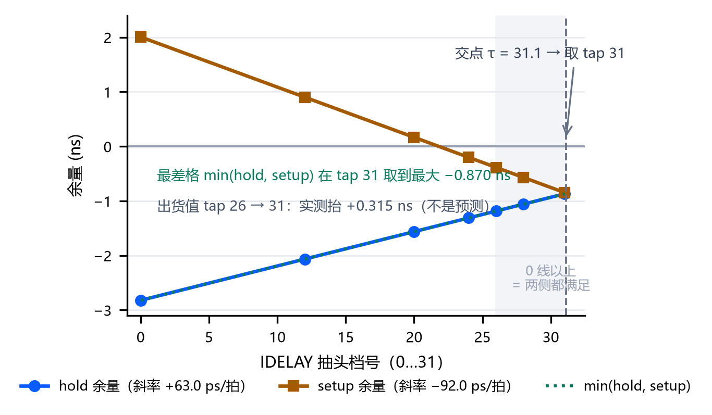

# 多源视频流多效果变换处理系统

> 器件 `xc7z020clg484-2`，工具链 Vivado / Vitis 2025.2.1，板卡 RK-ZYNQ7020-F。全文读数出自同一次构建：位流 `build/system.bit`，md5 前 12 位 `cb907d3e4898`，2026-10-17 11:35 产出；实现后时序报告、资源报告与功耗报告随包在 `build/reports/` 下。

## 摘要

系统要解决的问题是：一块 Zynq-7020 收到千兆网口推来的 512×300 RGB565 视频流，在可编程逻辑里完成几何变换与图像算法，再把结果推到 1024×600 的 HDMI 屏上，同时让人在同一帧画面里直接看到处理前与处理后的差别。协议栈、缩放、旋转、插值、六级效果链、混合与显示时序全部由硬件完成，处理器只负责命令解析、SD 卡读取与温度采样；推流这一路的像素，从入包到出屏不经处理器。

工作过程是这样的：PL 解析 UDP 包头，按载荷偏移把散包拼成整帧，作为 AXI 主设备写入 DDR3 的两块乒乓缓存；显示时读回来，依次经过缩放与旋转、六级效果链、左右对照混合和五行字符叠加，最后串行成 TMDS 出屏。效果链在任意算法组合下的延迟都是 15 拍，这一点由仿真测试台（testbench，下文简称台架）实测核对。片源有三路——网口流、SD 卡上的帧序列、PL 自绘的测试图卡——断流或拔卡自动回落，插回自动切回，全程不复位。

本版实测：四个时钟域在 51,027 个端点上没有 setup 与 hold 违例；30 fps 连续推流 300 秒共 9000 帧，丢帧、坏帧、重复帧都是 0；整屏逐像素比对判据 165 条全部通过；发布前的 24 项自动检查全部判定、0 项不通过。位流与固件写入板载 QSPI NOR 并逐字节回读一致；断电重上电那一次只做到现场目视，串口记录还没归档，所以这一条不写成已验证的自启。

**关键词**：Zynq-7020；千兆以太网；RGMII；UDP 视频流；乒乓帧缓存；双线性插值；同帧对照显示；TMDS

---

## 第一部分 作品概述

### 1.1 功能与特性

系统接收三种片源，输出一种画面：1024×600 的 HDMI 显示。默认片源是上位机经千兆网口推来的裸帧，入包、组帧与帧缓存管理都在 PL 内完成，像素不经处理器。缩放、旋转与双线性插值共用同一个逆映射算子，改一个不牵连另一个。六级图像算法由一个九位控制字逐位开关，任何组合下整链延迟都是 15 拍。

核心特性是同帧左右对照：一条竖缝把屏分成两半，左半显示原始像素、右半显示处理后的像素，两半取自同一帧的同一时刻，缝的位置是运行时参数。几何算错、丢列或填充越界会直接以台阶或黑楔形出现在屏上，判断效果不再需要采集卡、录屏或第二块屏。

屏上叠加五行字符，显示尺寸与帧率、片源、效果位、阈值、角度、缩放、缝位、时延和结温。链路的丢帧、坏帧与帧间隔由芯片自己统计，走串口与调试口读回，不占用画面。工程源码里 `src/rtl/hdmi/` 只有发送链，接入外部 HDMI 信号要在输入侧另加一颗 TMDS 接收芯片，这一条作为下一步列在 4.1。

### 1.2 应用领域

1. 机器视觉相机的现场监看。工业相机往网口推的是未压缩裸帧，产线调试最常见的故障是丢包让画面缺一块，而现场当时只看到"卡了一下"。本系统把丢帧与坏帧做成芯片内的计数，与画面同时读得到，看画面的人同时看得到链路质量。

2. 嵌入式图像算法的现场调参。做 FPGA 图像流水线的人需要在同一帧上比较算法前后，还要确认掉帧不是自己这一级造成的。今天这件事要笔记本、采集卡和两块屏，PC 上的预览与板上的流水线还不是同一份代码；本系统的同帧对照与芯片内计数正对着这个需求。

3. 教学与实验。83 支可复跑的仿真台架、一条命令的发布前检查和身份可核对的位流，使整套设计能被别人复跑和检验。

### 1.3 主要技术特点

1. 千兆以太网栈全部用可编程逻辑实现，含 RGMII 收发、MAC、IPv4 与 UDP 解析、ARP 和 ICMP 应答。推流占满带宽时板子仍可 ping 通，控制通路不会被数据通路拖死。
2. 三路片源共用一片 DDR，用乒乓缓存与单一写入者仲裁管理。写入者的变更经三级同步才送到写侧，所以切换与恢复都不需要复位。
3. 缩放、旋转与双线性插值共用同一组坐标运算单元，效果链延迟与开关组合无关。实际好处是增加算法或改参数时，读显存的调度不必重算。
4. 跨时钟域共四处：异步 FIFO 的格雷码指针、带翻转位的快照同步、GPIO 电平的三条同步链、单一时钟域内的状态选择。跨域一律三级同步并钉 `ASYNC_REG`，格雷码指针链单独钉，时钟分组显式声明（`src/constraints/clock_groups_impl.xdc`），异步组之外的跨域路才进时序检查。
5. RGMII 采样沿的位置是算出来再扫出来的：0 到 31 全档扫描，hold 每档约 +63 ps、setup 每档约 −92 ps，两线交点在 31.1，因此取 31（图7）。同一族路径里最差的那一格，从出厂值 26 档的 −1.185 ns 抬到 31 档的 −0.870 ns，抬幅 +0.315 ns 是实测值。

### 1.4 主要性能指标

只列已经量到的项目。绝对数取自 `build/utilization.rpt` 与 `build/timing_summary.rpt`，与指标表 `data/metrics.csv` 同源；两处不一致时以证据件为准。百分数按现件写，不做换算。

| 项目 | 数值 | 说明 |
| --- | --- | --- |
| 显示输出 | 1024×600 @ 59.5 Hz | 像素时钟 50 MHz（H_TOTAL 1344 / V_TOTAL 625） |
| 网口入流 | 512×300 RGB565，UDP 5001 端口 | 每包不超过 1392 字节，每帧 307,200 字节 |
| 传输质量 | 300 秒 / 9000 帧无丢帧、无坏帧、无重复帧 | 实测 29.99 fps，平均帧间隔 33.34 ms（min 20 / max 51）；另有一轮限速 15 MB/s 的 600 帧同口径零丢失 |
| 入流上限 | 不低于 116.7 fps 不丢字节 | 不限速打到目标 120 fps（约 36 MB/s、287 Mbps）共 960 帧不丢字节；还没压到过载点，所以这一格是下界不是最大值 |
| SD 卡播放 | 30 fps 上下 | 板上只搬运不解码；串口 `[STAT]` 与屏上帧号为 29.8–30.0 fps |
| 缩放 / 旋转 | 0.25 至 2.00 倍共八档（25/33/50/75/100/133/150/200），另有呼吸与自适应满屏；角度 1° 步进、0–359° | 双线性插值可关，倍率与来源都可机读回读 |
| 效果链 | 六级算法，任意组合延迟 15 拍 | 九位控制字逐位开关，内容平移四行 |
| 时序 | 四个受检域均无违例；最紧一格 0.687 ns，hold 侧最差 0.004 ns | 端点 51,027 个；汇总行见 `build/timing_summary.rpt` 第 151 行，第 154 行 "All user specified timing constraints are met"。逐域 setup：`eth_rxc` 0.687、`clk_fpga_0` 1.571、`clkout0_1` 3.287、`sys_clk` 14.294 ns，失败端点全为 0 |
| 资源 | LUT 14,013 / 53,200（26.34 %）、寄存器 8,132（7.64 %）、BRAM 96 / 140 tile（68.57 %）、DSP48 19 / 220（8.64 %） | 实现后报告；19 颗 DSP 的分解见 2.2.3 第 (6) 条 |
| 温度 | 满载结温 61.2–61.7 ℃ | 板内 XADC 六次读数的极值，取于 r113 那一版板；工具对现版的估算 52.6 ℃、置信度 Low |
| 功耗 | 动态 2.213 W，片上合计 2.390 W | 工具估算值，置信度 Low（没有仿真活动文件输入），不是实测 |
| 验证 | 整屏逐像素判据 165 条全过；发布前自动检查 24 项全部判定、0 项不通过 | 检查末行 `GATES: ALL PASS（24 项全部判定）`，随包件在 `build/reports/`；整屏台架留档 `build/tb_v98_report.txt` 头部带 `top_md5=c778dc4416b3`、`tb_md5=3975c335ab26`、`rtl_md5=93938780ccd6`，与现树同批 |
| 固化 | 位流与固件写入 QSPI NOR，逐字节回读一致 | 断电重上电的串口记录尚未归档，这一格不写成已验证自启；105 条串口命令回归上一版 98.2 秒全过，本版还没重跑 |

250 MHz 串行域（`clkout1_1`）不设时序检查项，这笔欠账记在 4.1。被异步时钟组屏蔽的跨域路径上，检查脚本按基线核减 CDC 报告的 Critical 配对（基线 4 行、本版 2 行），判"配对不新增、unsafe 不增长"；被核减的两条原因未查证，只登记不写成改进。

### 1.5 主要创新点

1. 同一帧内的左右对照显示。一条竖缝，左半原始像素、右半处理后像素，两半同帧同一时刻，缝位运行时可调。判断算法效果不再需要采集卡和录屏。
2. 与算法开关无关的延迟不变式。六级链任意组合都是 15 拍：每级自维护列标签，输出抽头按该级前的累积拍数选取。延迟恒定，缝才能放在任意列而不错位。
3. 换源与恢复都发生在消隐窗口内。三路片源共用一块 DDR、由单一写入者仲裁，拔线拔卡自动换源、插回即切回，全程不复位，屏上看不到半帧。

### 1.6 设计流程

起点是硬指标：屏 1024×600 @ 59.5 Hz 连续出图，片源 512×300 @ 30 fps。50 MHz 像素率下每像素只有 20 纳秒预算，逐像素操作放进软件就掉帧，软硬件划分由此定。

实现自底向上：先打通以太网收口，再做帧的进出与乒乓缓存，然后沿显示通路逐级搭起来。每个模块配一支台架，接口靠台架钉住。

联调分两步：先确认屏上出图正确，再把芯片内计数读出来与画面核对；问题能复现才修，修完回跑同一支台架。

发布阶段把位流与固件写进 QSPI 并逐字节回读，再跑 24 项自动检查与 165 条整屏判据；命令见 3.2.2。

---

## 第二部分 系统组成及功能说明

### 2.1 整体介绍

系统由片外的上位机、板载 PHY、DDR3 颗粒和 HDMI 屏，加上芯片内五只主要实例与一份 PS 裸机固件组成，关系见图1。图里分三条带：上排是像素走的数据通路，中排是 PS 与 PL 之间的寄存器通道，下排是时钟与复位。


| 实例 | 模块 | 时钟域 | 职责 |
| --- | --- | --- | --- |
| `u_bd` | `design_1_wrapper`（PS7 + AXI 互连 + 三路 AXI GPIO） | `clk_fpga_0` 100 MHz / PS | DDR 控制器、AXI 从口、PS 与 PL 之间的控制与状态通道 |
| `u_idelay_clkgen` | `clk_gen` | `sys_clk`→200 MHz | 只给收口的延迟单元提供参考钟 |
| `u_eth` | `eth_udp_video_top` | `eth_rxc` 125 MHz + `axi_clk` | RGMII 收发、协议解析、帧重组、写 DDR、链路计数 |
| `u_lm_axi` | `snap_cross` | `eth_rxc`→`clk_fpga_0` | 把健康快照同步到 PS 可读的窗口 |
| `u_pl` | `pl_video_top` | `clk_pix` 50 MHz + `axi_clk` + `sys_clk` | 显示通路：读回、几何、效果链、混合、字符叠加、TMDS |

数据流沿上排自左向右：报文经 RGMII 进 `u_eth` 完成解析与组帧，`u_eth` 作为 AXI 主设备通过 `u_bd` 的 HP0 端口把帧写进片外 DDR3；显示时 `u_pl` 从同一块 DDR 读回，经几何、效果链与混合后串行出屏。PS 的 `main.c` 把参数一次整字写入三个 AXI GPIO 从设备，状态经一条 32 位通道回读；上位机用 JTAG 读写的是同一组寄存器，所以不需要第四个通道。四处跨时钟域的安排见图2。


### 2.2 硬件系统介绍

#### 2.2.1 硬件整体介绍

整机由四件成品组成：RK-ZYNQ7020-F 开发板（`xc7z020clg484-2`，速度等级 2）、1024×600 HDMI 显示器、一根千兆网线、一台带有线网卡的 PC。板卡 12 V 直流供电，调试口是 USB 上的 FT4232 桥，A 通道走 JTAG、B 通道走串口。

| 资源 | 型号 / 规格 | 在本设计中的作用 |
| --- | --- | --- |
| 主芯片 | Zynq-7020，双核 Cortex-A9 加 7 系列 85K 逻辑单元 | 视频通路全在 PL，控制面在 PS |
| 晶振 | 50 MHz，接 `W17` | 派生像素钟与串行钟 |
| 主存 | 32 位 DDR3，DDR3-1066F | 乒乓帧缓存 |
| 配置闪存 | 32 MB QSPI NOR | 固化位流与固件 |
| 以太网 PHY | Realtek RTL8211F-CG，RGMII，用 PL 侧的 RJ45 | 收发延迟特性决定收口约束 |
| HDMI 座 | 三对数据一对时钟，TMDS_33 电平 | 板上没有缓冲芯片，由 PL 直接串行化 |
| 按键与指示灯 | 两键低有效，两枚 LED | 长按换源、短按调角度；心跳与异常指示 |
| 启动拨码 | JTAG / QSPI / SD 三档 | 调试用第一档，固化演示用第二档 |

PHY 有两点直接决定约束与判据怎么写。它的延迟配置脚与两位数据脚是复用的，板上用电阻上拉，结果是 PHY 主动把大约 2 ns 延迟加在接收时钟上，收口采样窗要按这个偏置来摆。另外实测发现链路断开时这颗 PHY 并不停止输出接收时钟，而是把它放慢到约 2.5 MHz（正常值的约 1/48）——"没有收到帧"和"用来计时的时钟已经不准"是两件事，判断链路是否活着必须同时看后者，这一条落到 2.2.3 第 (5) 条。

#### 2.2.2 机械设计介绍

本作品没有自主机械结构，开发板与显示器都是成品，用 HDMI 线与网线连接，没有需要设计的支架、外壳或光路。结构上唯一要考虑的是启动拨码与散热：演示时板卡平放、四周不留遮挡，1.4 的结温读数就是在这个状态下量得的。

#### 2.2.3 电路各模块介绍

按信号流从入口到屏逐级说明，通路细节见图3 与图4。

**（1）时钟与复位。** 板载 50 MHz 晶振是基准钟。`u_idelay_clkgen` 里一只 `MMCME2_BASE` 只产生 200 MHz，给收口延迟控制单元做参考（`src/rtl/clocks/clk_gen.v:15`）；`u_pl` 里另一只 MMCM 产生 50 MHz 像素钟 `clkout0_1` 与 250 MHz 串行钟 `clkout1_1`，喂给它的是 `sys_clk`（`src/rtl/top/pl_video_top.v:128`），两者锁定信号共同作为复位释放条件。100 MHz 互连域不用 PL 派生钟，直接由 PS7 的 FCLK_CLK0 输出（`build/report/clock_util.rpt` 的 g0 行）。

**（2）RGMII 收口。** 输入是 PHY 恢复出的 125 MHz 接收时钟、数据选通与四位数据。接收侧 `IDDR` 把双沿四位还原成单沿字节流，采样沿位置由 `IDELAYE2` 抽头决定（取值推导见图7）；发送侧 `ODDR` 合成。`mdc`/`mdio` 读写 PHY 寄存器，`rst_n` 完成上电复位。

**（3）入包与协议链。** `gmii_rx_mac` 去前导码并自算帧校验序列，`udp_rx_parser` 解析 IPv4 与 UDP 头、只放行 5001 端口，`frame_reasm` 按载荷在帧内的偏移写入对应行、行数满足后提交整帧。`arp` 与 `icmp` 与推流并行应答，这一层由 `sim/tb_icmp_ping0.v` 等四支台架回归。发送方向由 `eth_ctrl` 仲裁、`udp_tx` 拼包头、`crc32_d8` 补校验，RGMII 合成件是 `src/rtl/eth/gmii_to_rgmii.v`。出处要交代：这一层与 RGMII 收发的初版来自板卡厂商的 `eth_udp` 例程，本工程改写了五处——组帧判据、端口过滤、把 PL 改成 AXI 主设备直写 DDR、健康计数、采样窗。

**（4）DDR 写入与乒乓提交。** 16 位字节流先过一颗格雷码指针的异步 FIFO，把速率差与时钟域差一起消化，再由 `axi_frame_saver64` 拼成 64 位 AXI 突发，写入网口那一路的两块乒乓帧区（`0x1000_0000` 与 `0x1008_0000`；PS 那一路用第三块 `0x1010_0000`）。整帧写完后 `ddr_bank_commit` 发换页脉冲，读写两侧不会同时落在同一块上。

**（5）链路健康与仲裁。** `link_monitor` 在接收域用毫秒计数判静默（阈值 `TC = CLK_HZ/1000`），输出十组计数：收包、坏帧、重复帧、丢帧与帧间隔的当前值与极值。断链时时钟变慢而不是停止，所以心跳位与一个独立的慢速判据先合成"时基可信"信号，才作为仲裁输入；否则会出现计数没涨但时基已经不可信的误判。`frame_commit_lock` 管消隐窗口与看门狗，`src_life` 提供 500 ms 心跳。仲裁状态是 `M_AUTO / M_ETH / M_TEST / M_SD` 一个二位 localparam（`src/rtl/top/pl_video_top.v:152`），owner 变更那条跨域路有专项 CDC 判据，在发布前检查的第 6 项。

**（6）几何。** `video_timing` 给显示坐标，`zoom_fit` 算自适应满屏系数，`zoom_mapper` 做含旋转的逆映射并输出源坐标与越界标志，角度由 `angle_ctrl` 以 1° 步进、正余弦查 ROM，双线性再做两次线性内插，读口按 `BILIN_ROWS = 2` 的行缓存供数。旋转态下画面四角是否出屏，由 `sim/tb_v96_zoom_scan.v` 用两端夹逼的映射判据 M1/M2/M4/M6 判定，不靠人眼。全设计 19 颗 DSP48：插值 6、缩放映射 8、自适应系数 3、模糊 1、分割控制 1；gamma 查表实现，不占 DSP。

**（7）效果链。** `proc_pipeline` 按 gamma、颜色、滤波、边缘、阈值、形态学六级排列，九位控制字一位一种算法；第六级腐蚀与膨胀互斥，同时置一时两个都不做——开/闭要两遍 3×3 窗口，这里只有一遍，所以明确旁路。四个需要邻域窗口的级别各自维护列标签，输出抽头按该级前的累积拍数选取（累积 2 拍后接模糊、5 拍后接锐化、8 拍后接边缘、12 拍后接形态），因此任意开关组合下整链都是 15 拍、内容平移四行（图8）。顶层只引用模块参数 `LATENCY`，`sim/tb_v86_pipe_sel.v` 实测输入有效脉冲到输出有效脉冲的间隔与之一致。

**（8）同帧混合、字符叠加与 TMDS。** `split_display` 按缝位置逐列选原始或处理像素；原始像素来自一条四行行缓存加一级滑移，与处理路径同拍，所以两半确实同帧。`osd_overlay` 叠五行字符。`rgb2dvi` 里三个 TMDS 编码器配四个串行器，用 `OSERDESE2` 在 250 MHz 做 10:1 串行，电平 TMDS_33 直连 HDMI 座。


### 2.3 软件系统介绍

#### 2.3.1 软件整体介绍

PC 上位机负责推流、取数与判定，PS 裸机应用负责命令、寄存器、SD 卡与温度，PL 对外只暴露它接受的那组寄存器接口。三层之间只有两条通道：UDP 5001 的视频流，和三个 AXI GPIO 从设备的寄存器读写；上位机经 JTAG 读写的是同一组寄存器，所以串口看到的与调试器看到的必然一致。

上位机共 29 支脚本，不依赖第三方库。常用三支：`src/host/video_sender.mjs` 推任意片源，`src/host/one_click_test.mjs` 把 ping、经 JTAG 写读状态、发内置片源、计数对账串成一次自检（任何一步失败都以非零码退出），`src/host/uart_cmd_check.mjs` 驱动 105 条命令回归。其余是量问题的尺子，例如几何回读校验、DDR 内容核对、流水线延迟核对。PS 侧 2,544 行 C 跑在 Cortex-A9 上，板级支持包由随工程导出的 Vitis 平台提供。这里没有用操作系统：需要的只是串口、SD 卡、GPIO 与一个主循环，这个规模上引入操作系统的开销与调试复杂度大于收益。主循环与命令分发的流程见图5。


#### 2.3.2 软件各模块介绍

主循环每轮做四件事：收串口命令（补缓冲、切词、分发）、采一次 XADC 温度、处理 SD 卡拔出与重挂、把表示"活着"的翻转位发布出去。输入是一行串口命令与寄存器当前值，输出是三个 32 位控制字与串口回显。

| 模块 | 主要函数 | 输入 → 输出 | 说明 |
| --- | --- | --- | --- |
| 控制字合成 | `ctrl_write`、`ctrl_apply` | 内部参数 → 32 位整字 | 三个写通道各自整字一次写出 |
| 命令分发 | `dispatch`、各 `cmd_*` | 一行命令 → 写进控制字并回显 | 覆盖片源、填充、分割、缩放、旋转、插值、字符叠加、gamma、阈值、温度与状态回读；参数不区分大小写，非数字即判参数错 |
| 缩放档 | `zoom_parse_x100`、`zoom_step_near` | 百分数 → 八个定点档之一 | 命令可给任意倍率，落到最接近的一档 |
| gamma | `gamma_curve`、`gamma_set`、`gamma_tick` | 一个系数加索引 → 表窗口 | 软件只写表，逐像素查表由 PL 完成 |
| SD 卡与文件系统 | `sd_mount`、`dir_lookup`、`fat_next`、`feed_cur` | 文件名 → 扇区 → 帧 → DMA 进 DDR | 自己解析 FAT32，并校验同名说明文件里的帧数与宽高；处理插拔重挂；不解码，只搬预转换好的裸帧 |
| 温度与状态 | `temp_poll`、`ps_publish` | XADC 读数 → 屏上字符与 GPIO 值 | 同一个温度有三处读数：驱动、屏上、写进 PL 的寄存器，用来互查 |
| 状态回读 | `lane23` 一组 | 32 位状态通道 → 倍率、来源、手自动、插值 | 串口 `[STAT]` 一行的字段顺序钉在 `src/ps/main.c:1381` 的格式串上（`[STAT] ctrl thr=%d` 前缀），命令回归与板级校验脚本按同一前缀解析 |

寄存器接口是软硬件之间唯一的约定。三个写通道分别承载基础控制、几何与算法选择、gamma 表窗口，一个读通道按编号返回 32 位状态。

| 通道 | 地址 | 承载内容 |
| --- | --- | --- |
| `gpio_o` | `0x4120_0000` | 边缘阈值、片源选择、呼吸开关、双线性开关（`gpio_o[19]`）、字符叠加总开关（`gpio_o[20]`，反相，复位值 = 有叠加）、帧间隔统计清零、状态通道编号 |
| `gpio_cfg1` | `0x4122_0000` | 六级算法的九位开关、自动旋转与转速、分割缝位置与自动扫描、缩放档位与手动标志、自适应满屏 |
| `gpio_cfg2` | `0x4122_0008` | gamma 使能、表项写入握手、表索引、屏上显示的 gamma 格与温度格 |
| 状态读回 | `0x4121_0000` | 按编号选一条 32 位状态：丢帧、坏帧、包数、帧间隔、缩放回读、时延分段、时基可信位；收包/坏帧/重复帧/帧间隔这组走 `lane8`、`lane9`，不在 `[STAT]` 回显里 |

有一条纪律：控制字必须整字一次写入，不许按位读改写，PL 收到后统一打三级同步。钉住这条约定的注释在 `src/rtl/process/effect_ctrl.v:31`——`stage_sel`、`zsel`、`manual` 三个字段并到同一条同步链，分两组同步就会出现"标志到了、档号还是上一次的"那类错拍，在 100 MHz 互连域与 50 MHz 像素域之间就会看到只更新了一半的参数。

三条通道与观测点的关系见图6。


---

## 第三部分 完成情况及性能参数

### 3.1 整体介绍

整机已经完成，上位机推流、板卡处理、屏上显示、串口与 JTAG 读回四条通路同时成立。位流与固件已写入板载 QSPI NOR 并逐字节回读一致；断电重上电只做到现场目视，缺什么、怎么补见 3.2.2。

【照片 1｜整机正面与斜 45° 全景】正面拍到板卡与屏上画面（屏上五行读清）加网线与电源；斜 45° 能看出网口进、HDMI 出的接法。屏下留出板卡与线材，让人看出是一台完整设备。

### 3.2 工程成果

#### 3.2.1 机械成果

无自主机械结构，没有机械成果件；板卡与显示器用现成支架与桌面摆放。

#### 3.2.2 电路成果

| 成果件 | 内容 |
| --- | --- |
| 位流 | `system.bit`，约 2.2 MB，md5 前 12 位 `cb907d3e4898`（2026-10-17 11:35 产出，日志 `build/r132_streamwrap_build.log`） |
| 硬件描述 | `system.xsa`，Vitis 平台由它导出 |
| 固件 | `ps_app.elf`，链接在片内存储的高段 |
| 启动镜像 | `BOOT.bin`，共 2,435,868 字节，含第一级引导、位流与应用程序，由 `board/scripts/make_boot_image.sh` 产出 |
| 烧写 | 板载 32 MB QSPI NOR（丝印 W25Q256FV，3.3 V，挂 PS 的 MIO1–MIO6 = CS/DQ0–DQ3/CLK；烧写选 `mx25l25645g-qspi-x4-single`），擦写后回读校验通过 |
| 烧写留档 | 逐条结果（镜像与三份输入的 md5、Erase/Program/Verify 三行成功、耗时 137 s）在 `board/measured/flash_qspi_2026-10-05.txt`；`PROGRAM.VERIFY=1` 那一步是从 flash 读回逐字节比对，所以"Verify successful"是片上内容与 `BOOT.bin` 一致的证据 |
| 断电自启 | 上一版镜像那一次冷上电有记录：`board/measured/qspi_coldboot_selfboot_ok_2026-10-06.txt` 第 14 行 `Boot mode is QSPI`、第 66 行 `FPGA Done`、第 109 行 `SUCCESSFUL_HANDOFF`。板上这一版只到目视程度：启动档在 QSPI、断电十秒以上冷上电、串口文本与屏上那一眼一起留下——这一份还没做 |

烧写这一步踩到三个坑，写在这里免得重复走。bootgen 对 Zynq-7000 只接受"`the_design:` 加花括号里逐行一个文件、不写逗号不写属性"这一种 bif 写法。部件名不能照板子丝印填：丝印是 W25Q256FV，而 Vivado 部件库里 `w25q256jw*` 那一支的 `COMPATIBLE_PARTS` 只列 zynquplus，给 zynq7000 用会报 `[Labtoolstcl 44-655]`；要挑的是 `COMPATIBLE_PARTS` 里含 `zynq7000*` 的那一支同为 32 MB / x4 的 macronix 档，用 `get_cfgmem_parts` 列出来按这个属性选，换过去擦写与回读校验都通过。2025.2.1 的 `hw_cfgmem` 对象没有 `PROGRAM.ADDRESS_RANGE`、`BBF_FILE`、`START_ADDRESS`、`STATUS` 这几个属性（写死会 17-142、17-54 中断），又必须设 `PROGRAM.ZYNQ_FSBL`，缺它报 `[Labtools 27-3203]`。

```bash
# Vivado：建工程 → 综合 → 实现 → 位流
<DV>/bin/vivado.bat -mode batch -source build/tcl/build_system_axigpio.tcl
bash build/gates.sh                                # 发布前自动检查（24 项）
```

```bash
export VP_XSDB="<Vivado>/../Vitis/bin/xsdb.bat"
bash build/board_verify.sh --geom --battery        # 板级回显与几何判据，留原始日志
```

```bash
export VP_VIVADO_BIN="<Vivado>/bin"
bash board/scripts/make_boot_image.sh              # 第一级引导 + 位流 + 应用 → BOOT.bin
VP_QSPI_PART="mx25l25645g-qspi-x4-single" \
  "<Vivado>/bin/vivado.bat" -mode batch -source board/tcl/flash_qspi.tcl
```

上板工程本身的落位与验证写成两支脚本（`board/tcl/stage_board_projects.tcl`、`board/scripts/stage_vitis_platform.sh`），判据与实跑读数在 `board/measured/stage_2026-10-05.txt`。整屏台架的重跑通道是 `bash build/sim/run_one.sh tb_v98_top_seam`。

【照片 2｜板卡顶面特写】标出 PL 侧 RJ45（PHY2，Realtek RTL8211F-CG）、HDMI OUT 座、启动拨码（QSPI 档）与 QSPI NOR 丝印 `W25Q256FV`。

【照片 3｜断电自启瞬间（待补拍）】现版还欠这一份：拨码打在 QSPI 档、断电十秒以上再上电，屏自己出画面（无 PC 参与），串口窗口里留着启动提示行；屏与终端同框，再拍到 `[STAT]` 统计行、`lane23` 回读行和屏上同一组数。拍到并归档，断电自启才从目视升级为可核对的凭据。

#### 3.2.3 软件成果

上位机一条命令推流、一条命令自检；PS 侧串口控制台 115200-8N1，105 条命令回归跑完约 98 秒，跑完回到初态。耗时只报有出处的两个数：从空工程到出位流一次实测 19 分 30 秒（综合 10 分 09 秒、实现含出位流 7 分 22 秒，日志 `build/r132_streamwrap_build.log`）；整屏逐像素台架跑完一遍 3 小时 21 分 55 秒（同一次留档的时间戳差）。

图9 到图11 是上位机用同一套算法在 PC 上重算的参考画面，与屏上实拍对照，检查硬件实现是否与软件模型一致。看的是列对齐与边界：图9 看竖缝两侧是否同帧，图10 看六级全开时边缘与形态学的连通域，图11 看 45° 旋转后插值是否还保持直线。




【照片 4｜上位机截图】推流窗口正在发包的那一行，紧随其后一键自检四步各自的 PASS。

【照片 5｜串口与屏同框】统计行、温度行、状态回读行，与屏上同一组数。

【照片 6｜屏上实拍与参考图同框（待补拍）】按图9/图10/图11 各自的参数（竖缝 50 %、六级全开、旋转 45°）在屏上实拍同一帧，与参考图并排贴出，用来支撑"硬件实现与软件模型一致"这一条。

真实串口回显片段（命令回归的留档形态）：

```text
[CTRL] mode=0 src=1 bilin=1 zoom=100 angle=000 split=50
[STAT] rx=  9000  bad=0 dup=0 lost=0 gap_min=20 gap_max=51 avg=33.34 fps=29.99
RESULT board_verify PASS（判红的步骤：0）
```

### 3.3 特性成果

功能与结果一张表，逐路径明细另放附表。

| 功能 | 结果 | 依据 |
| --- | --- | --- |
| 网口入流 | 512×300 @ 30 fps 连续 300 秒共 9000 帧，丢帧、坏帧、重复帧均为 0，实测 29.99 fps | 板内自行统计的计数；33.34 ms 是 PL 收包链的相邻两帧入流间隔（min 20 / max 51），不含编码、网线与交换机排队 |
| 入流上限 | 不低于 116.7 fps 不丢字节，尚未压到过载点 | 不限速长跑 960 帧 |
| 推流期间的控制通路 | 带宽占满时 ping 仍有回包 | 主机侧 `one_click_test` 第一步 |
| 缩放 | 0.25 至 2.00 倍八档，另有呼吸与自适应满屏，倍率可机读回读 | 状态通道回读与屏上量格 |
| 旋转 | 步进 1°，逆映射加双线性，四角是否出屏由台架判定 | `tb_v96` 的 M1/M2/M4/M6 |
| 效果链 | 六级九位开关，任意组合延迟 15 拍、内容平移四行 | 每级一条旁路判据加实测间隔（`tb_v86`） |
| 左右对照 | 缝位置运行时可调，改参数不影响对照标记本身 | 串口 `split<n>` 判据 |
| 字符叠加 | 五行齐全。字模索引先在整个有效区整屏走一遍；再把索引故意超出有效范围，累计 190,464 个越界周期作分母，用来区分"越界已被拦截所以屏上没现象"与"拦截没生效"这两种情况 | 按功能逐项目视核对的验收清单，逐行在 `board/verify_r87.md` |
| 片源回落 | 拔网线、拔卡能切走，插回能切回，不需要复位 | 板级现场复验 |
| 时序 | 四个受检域均无违例；最紧一格在校验和进位链上，排在其后的十几条是使能广播，瓶颈性质不同 | 实现后报告，明细见附表 |
| 资源 | LUT 26.34 %、寄存器 7.64 %、BRAM 68.57 %、DSP48 8.64 % | `build/utilization.rpt` |
| 验证覆盖 | 台架 83 支（取舍清单在 `sim/README.md`）；整屏判据 165 条全过；发布前检查 24 项全部判定、0 项不通过；105 条命令回归上一版 98.2 秒全过、本版未重跑 | 检查与留档件，指纹见 1.4 |
| 固化 | 位流与固件写入 QSPI 并逐字节回读一致；断电重上电只到目视程度 | 写入与回读日志；缺同一次串口记录文件 |

另有 5 支变异对照（`build/sim/mut_control.sh` 生成）：一次变异只许红它声称红的那一条，判据若靠空集通过本身算失败。

**附表：逐路径明细（现版 r132 与对照轮 r118）**

| 轮 | 域 | 余量 | 路径 | 级数与布线占比 |
| --- | --- | --- | --- | --- |
| r132 | `eth_rxc` | setup 0.687 ns | ICMP 发送状态机 → IP 首部复位脚（`u_icmp_tx/FSM_onehot_cur_state_reg[6]/C → ip_head_reg[4][10]/R`） | 5 级，布线 79.96 % |
| r132 | `clk_fpga_0` | setup 1.571 ns | 仲裁所有权标志 → 双线性帧缓存 BRAM 地址脚（`u_arb/owner_eth_reg/C → u_bilin/u_fb/lo_reg_0_40/ADDRARDADDR[7]`） | 1 级，布线 92.71 % |
| r132 | `eth_rxc` | hold 0.004 ns | 收包有效位 → 字节计数（`u_rx_par/p_valid_reg/C → u_reasm/stat_bytes_reg[0]/D`） | — |
| r118 | `eth_rxc` | setup 0.739 ns | IP 首部 → 校验和缓冲（`u_icmp_tx/ip_head_reg[4][16] → check_buffer_reg[19]/D`） | 11 级含 6 个 CARRY4，布线 58.4 %；同一只锥贡献前 3 档 0.739 / 0.873 / 0.961 |
| r118 | `eth_rxc` | 第 4–12 档 | 帧尾标志 → 行数命中使能（`u_rx_par/p_eof_reg → u_reasm/rows_hit_reg[*]/CE`） | 4 级，布线 85 %；整族搬走的上界 +0.278 ns |
| r118 | `clk_fpga_0` | setup 1.850 ns | 前 12 档同起点 `u_arb/owner_eth_reg/C`，终点是帧缓存 BRAM 的写使能与地址脚 | 1–4 级，布线 88.8–93.6 %；该域没有算法锥可拆，能动的是这只高扇出标志的复制与摆放 |

### 3.4 优化前后的性能与资源对比

口径先说清：判的是同一个时钟、同一条逻辑锥（同一组关键路径）自己动没动。全局 WNS 的绝对差不写成收益也不写成损失，放置本身就会让它摆到零点几纳秒。"依据"一列只指得出翻得到的件：本版两份报告在 `build/reports/`，更早几批的读数照抄在 `report/optimization_log.md` 的跨全期累计对照与逐轮小节，每行注明出自哪一次检查输出。

| 批次 | 改动 | 改前 | 改后 | 代价 | 结论与依据 |
| --- | --- | --- | --- | --- | --- |
| 第 75 批 | 字符叠加的字格几何（除法与取模）单独寄存一拍，把它从最差锥里挪走 | 该锥挂在全设计最差名单上 | 移出最差名单；那一版记录 WNS +0.287 ns，LUT 14776（27.77 %） | 多一级寄存器、输出晚一拍（对面板不可见） | 采纳；读数照抄在 `report/optimization_log.md` 的 r75 行 |
| 第 86 批 | 诊断计数器的使能改喂"寄存过的事件"，不再用组合脉冲 | 目标族失败 setup 端点 **16** 个 | **2** 个 | 同批全局 WNS −0.135 ns，按上面的口径不记成损失 | 采纳；判据是端点数不是 WNS 绝对值 |
| 第 88 批 | 双口 FIFO 的满判据改用当前写指针 | `u_cdc` 一族在最差名单上 | 整族从最差名单消失；收侧 `eth_rxc` 那一版 WNS +0.516 ns | 该批发布前检查 18 项全过、2 项因缺同一次台架证据件未判 ⇒ 当时不算"过了检查的一版" | 采纳上板；读数在 r88 行，这一刀记在 `report/log/issues.md` #139 |
| 第 89 批 | 给那 9 块 FIFO BRAM 画一块 Pblock | 目标族本来就不在最差名单上 | 无可归属收益；收侧 WNS +0.516 → +0.363 ns | 担了摆放约束的风险 | **否决**；0.516 → 0.363 落在构建摆幅内 ⇒ 没有可主张的改变（#146） |
| 第 90 批 | 帧缓存 `mem[0:38399]` 拆成三块 2 的幂深度 | BRAM 95 片 | 省 5 片 RAMB36（88 片、64.64 %） | 收侧 WNS +0.516 → +0.232（拆）→ +0.182（拆后再加一级寄存），最差级数 4 → 9 → 4 | **否决**：省下的块 RAM 买不回那条收侧余量；`report/optimization_log.md` 第 623–665 行 |
| 本版 | 发布位（不再改动） | — | 四个受检域 setup/hold 零违例（失败端点 0 / 51,027）；最紧在收侧 `eth_rxc` 0.687 ns；LUT 26.34 %、BRAM 68.57 % | 见 1.4 | 随包 `build/reports/` 下这一版的检查末行与实现后时序摘要 |

被否决的行留着不删，是因为"试过、量过、判不值得"这条信息本身要能看见。哪一批只剩单侧读数就得在同一行标成未量化，不拿相邻批次顶替。资源侧只收有账可查的三笔增减（量自 `data/metrics.csv` 与 `build/evidence/` 逐层件）：`pay_start`/`pay_end` 提前一拍寄存，寄存器 +22；行覆盖使能独热化，LUT −243，其中 −66 能归到这一刀，没有归属的部分不念成收益；两只按键去抖的武装门加校验和累加器 32→2，LUT +35、寄存器 +34，净账由两份逐层件相减闭合。

还有几刀时序改动被实测否掉，每条都是别处赢了、这一处输了：

- 校验和摊到每拍一项：`eth_rxc` 0.739 → 0.691 ns，但 `clk_fpga_0` 掉 −0.123 ns、`sys_clk` 从 14.876 降到 14.068 ns，判负回退（#380）。
- 编译期常量抽出发一拍更差：常量并入同一拍使加法树变深，那条锥的失败端点只从 4835 减到 4819（#382）。
- 强制复制 239 引脚的广播网：本域赢 1 格、另三域跌 4 格且含最紧两格，判负（`report/timing/round_r117.md`）。
- 用 Pblock 圈住载链：路径逃出分区边界，报 Place 30-439 且没有收益（#186）。
- 把 RGMII 输入窗直接挂上去：`eth_rxc` 当场 −2.885 ns，退回成候选件。
- 为保 setup 余量动块 RAM 那一族：+0.182 ns 换不回 +0.516 ns，砍掉触发器后最差路径仍剩 4 级，说明拥塞才是主导（#122）。

这一族的总结在 `report/timing/eth_rxc_partition_options.md` 第 8 节：本版不再投时序优化轮——现在是零违例、约束全满足的状态，继续动它买的是余量不是正确性。

---

## 第四部分 总结

### 4.1 可扩展之处

1. 屏这一路的对外时序还没有结论：六个 TMDS 输出口目前只量到离散量，源端窗口写进约束、走线失配扣除与眼图测量都还欠着，250 MHz 串行域因此不设检查项。
2. 端到端时延的入口与出口分两次测，需要一次测完整给出；屏上 `Latency` 那格至今没有真值，指标里记"未报"。
3. 收口余量：接收时钟扇出偏大，设想拆开并加一级短捕获时钟，但捕获沿提前会留下约 3.07 ns 发射/捕获差，而该族最重的锥实测要 7.066 ns，大概率反而违例，所以不能单独落（账在 `report/08-limits.md` §5）。
4. 帧率与画幅同受消隐窗口限制；要更高分辨率或更多片源，改的是这个窗口与 DDR 分区。H.264 解码、丢包重传、多屏同步不在本版。
5. 输入侧现在靠上位机推裸帧；加一颗 TMDS 接收芯片，同一套通路就是带对焦辅助与伪彩的现场监视器。

### 4.2 心得体会

这个项目对我改变最大的一点，是把"做完了"的标准从"看起来对"换成了"有一条能红的判据"。

最疼的一次是全绿并不代表对。有五支台架、56 条检查项全部通过，我把那一轮记成了通过。后来翻综合报告才发现被测的那条逻辑根本不存在——边界判断的一侧接了常数，被综合直接优化掉了。此后我要求每条判据都必须能红：一条永远不会红的判据，即使跑通了也不能算数。为此写了一个变异脚本，把修复之前的写法原样复原一次，判据仍然不红就报变异失败。还有一次是循环变量只有两位宽而上界写到了 4，那一档永远进不去，一屏 PASS 而整轮检查从未执行。这两件事之后，我看任何"通过"之前会先看它实际覆盖了多少样本。

第二次收获来自一个被实测推翻的假设。原本以为拔线之后 PHY 会停止输出接收时钟，所以判断链路静默只看计数是否增长。真拔一次线，计数确实不涨，但画面也没有交还给 SD 片源。查下去才知道这颗 PHY 在断链时不停振，而是把时钟放慢了几十倍——用来计时的时钟本身在说谎，"毫秒计数没有超过阈值"这句话可以连续十几秒成立。解决办法是承认测量结果，把时基是否可信做成仲裁的一个输入，再加一个独立心跳位。同样被实测否掉的还有强制复制广播网络与直接挂上 RGMII 输入窗——一挂整个时钟域全红。这些失败我都留了记录，把过程删掉之后，结论就没有可以核对的链条了。

第三点体会是时序要靠算和扫，不能靠猜。RGMII 采样沿的位置是先建模再取整得到的（图7 就是那一次扫描的结果）；同样的做法用在时钟不确定度上，给四个域统一加 0.8 ns 之后量出两万多条保持时间违例，数据不支持，这个设置就不采纳。看关键路径也不能只看全局最差那一条：最差那条是校验和进位链，排在其后的十几条全是使能广播，两者性质不同，能做的事情也不同。

最后是协作方式。以把关为目的的检查脚本必须串在被它保护的动作前面，否则它只是告诉你不合格，并不会拦住你。跨域清单也是同一件事：发布前检查把 CDC 报告的 Critical 配对按基线核减（基线 4 行、本版 2 行），两条被核减的配对 `eth_rxc>clk_fpga_0`、`eth_rxc>clkout0_1` 的原因至今未查证，只登记、不写成改进。至于和大模型一起工作，我的口径是：没有逐条核实过的统计没有意义，没有验证过的说法不能当结论，一条判据到底能不能红，只有机器跑一遍才算回答。

回头看，这个系统真正站得住的两条都很朴素：把每像素 20 纳秒的预算当作软硬件划分的依据，推流那一路从收包到出屏就没有一处逐像素的软件参与；把让硬件自己数自己的账当作观测面，屏、串口和 JTAG 就天然同源。这两条不是一开始就想清楚的，是在一次次判红之后被逼出来的。

---

## 第五部分 参考文献

[1] HDMI Forum. High Definition Multimedia Interface Specification Version 1.4, Section 4.2.4, Table 4-24 (Source Timing Requirements). HDMI.org, 2013.
[2] Arm Ltd. AMBA AXI and ACE Protocol Specification, AXI3, Issue J (IHI 0022J). Arm, 2023-03, 273 p.
[3] Arm Ltd. AMBA AXI and ACE Protocol Specification, Issue H (IHI 0022H). Arm, 2020-04, 500 p.
[4] Realtek Semiconductor Corp. RTL8211F-CG 10/100/1000M Ethernet Transceiver Datasheet, Track ID JATR-8275-15, Rev 1.4, Table 10 & Table 60. Realtek, 2018.
[5] Xilinx Inc. Zynq-7000 SoC Technical Reference Manual (UG585), v1.13. AMD/Xilinx, 2021-04-02.
[6] Xilinx Inc. XC7Z010/XC7Z020 Data Sheet: DC and AC Switching Characteristics (DS187), v1.21. AMD/Xilinx, 2020-12-01.
[7] Xilinx Inc. Vivado Design Suite User Guide: Using Constraints (UG906), v2025.2. AMD/Xilinx, 2025-12-10.
[8] Xilinx Inc. Vivado Design Suite User Guide: Implementation (UG949), 中文版 v2024.2. AMD/Xilinx, 2024-12-18.
[9] Xilinx Inc. 7 Series FPGAs Memory Architecture User Guide (UG473). AMD/Xilinx.
[10] Xilinx Inc. 7 Series FPGAs Clocking Resources User Guide (UG479). AMD/Xilinx.
[11] Xilinx Inc. 7 Series FPGAs SelectIO Resources User Guide (UG471). AMD/Xilinx.
[12] Xilinx Inc. Zynq-7000 SoC XADC (UG835). AMD/Xilinx.
[13] Xilinx Inc. AXI GPIO v3.3 Product Guide (PG054). AMD/Xilinx, 2017-10-04.
[14] Xilinx Inc. Interfacing DDR SDRAM with the Memory Interface Generator (XAPP793), v1.0. Xilinx, 2012-09-20.
[15] Micron Technology. MT41K256M16 4Gb DDR3 SDRAM Mobile DRAM datasheet, Rev. Q. Micron, 2017-12.
[16] AMD/Xilinx. Vivado Design Suite & Vitis Unified Software Platform 2025.2.1 (build 6403652) Release Notes and Installation Guides. 2025.
[17] RK-ZYNQ7020-F 开发板用户手册 V1.0（第 7、36 页）与 ZYNQ7020-F+V1.1 原理图（第 8 页 PHY 引脚复用表）. 板卡资料.
[18] Keysight Technologies. D9021HDMC HDMI Source Compliance Test Application Programmed Reference Guide, 9924-01437, 74 p.; Tektronix Inc. TDS/HT3 HDMI Source Test Application Reference Guide. （仪器厂商与应用笔记的转述资料）
[19] DVI Test & Measurement Guide, Rev. 1, 26 p.（DVI/HDMI 源端信号量测方法参考）
[20] RK-ZYNQ7020-F 开发板厂商例程 RTL：`eth_udp` 以太网协议栈（`arp`／`icmp`／`udp`／`eth_ctrl`／RGMII 三件的初版来源）. 板卡资料配套例程.

---

## 附录 证据层与读数出口

数字的唯一出口是 `data/metrics.csv`，每行点名它的证据文件；文档读数与该冻结件同源，不一致时以证据件为准。逐轮改动的账面在 `report/optimization_log.md`，逐轮时序读数在 `report/timing/` 的逐轮页。构建、发布前检查、整屏台架重跑与板级校验四条命令的原文见 3.2.2 的代码块；上板工程落位与验证两支脚本的实跑读数在 `board/measured/stage_2026-10-05.txt`。三条约定的核对方式：`Latency` 契约由 `tb_v86` 实测钉住，映射判据 M1/M2/M4/M6 在 `tb_v96`，`[STAT]` 一行的字段顺序钉在 `src/ps/main.c` 的格式串上，改格式等于拆尺子。目录分工：`src/` RTL 与固件与上位机与约束，`sim/` 台架，`board/` 上板工程与实测输出，`data/` 测试向量与黄金参考与指标表，`skill/` 技能包 49 条，`report/` 设计报告与协作记录，工作记录在 `report/log/`。
