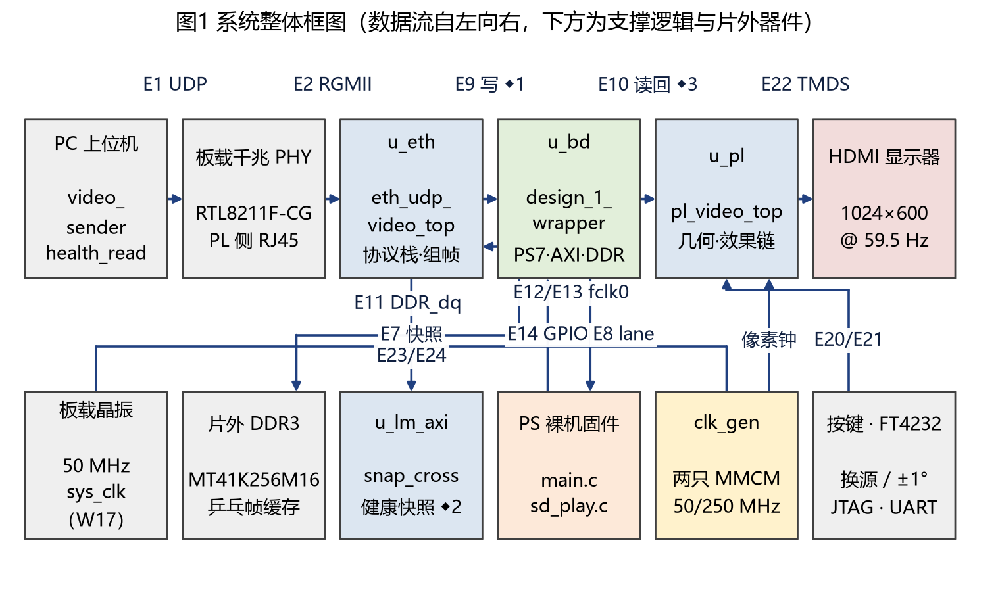
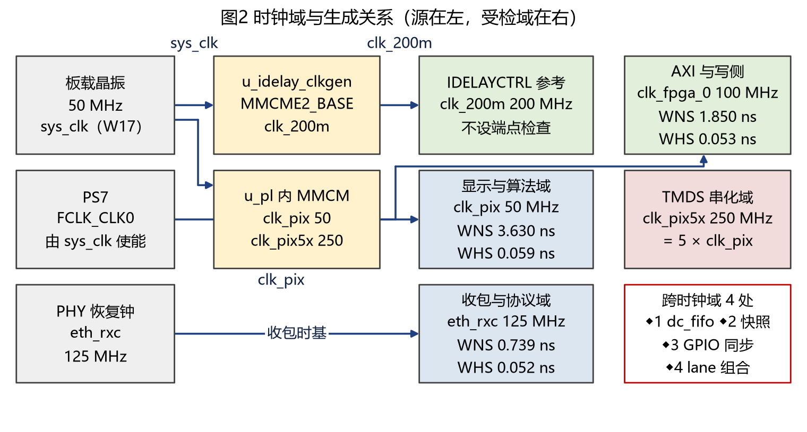
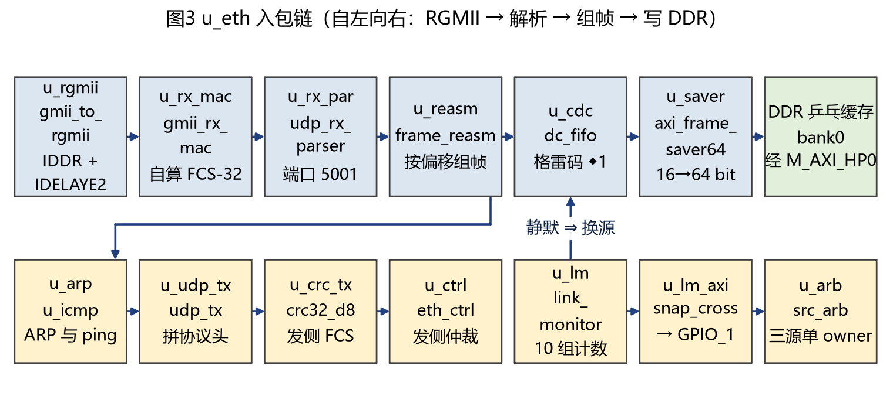
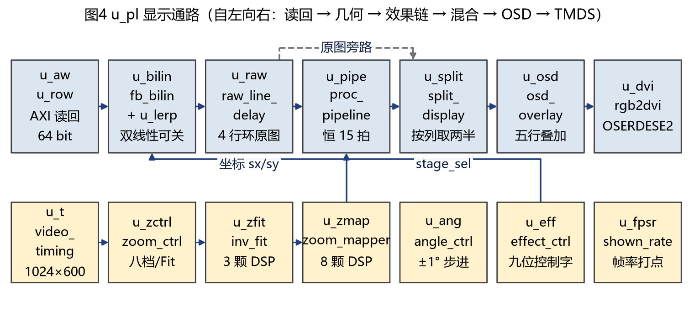
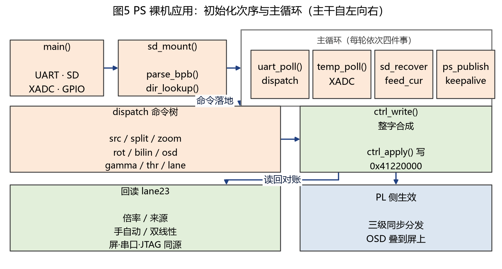
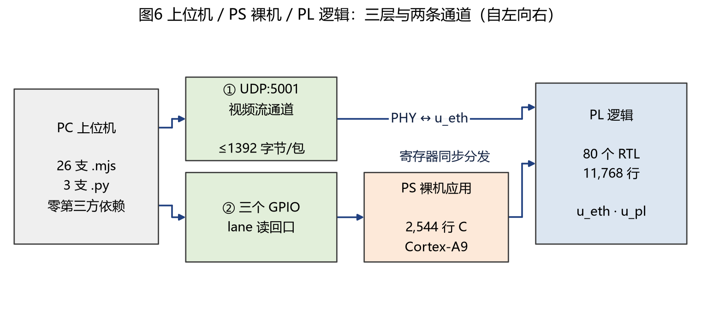
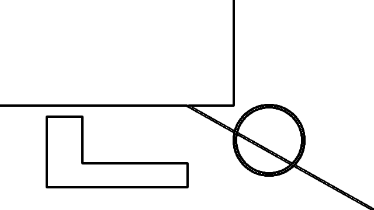

# 多源视频流多效果变换处理系统

> 器件 `xc7z020clg484-2`，工具链 Vivado / Vitis 2025.2.1，板卡 RK-ZYNQ7020-F。对应的位流是 `build/system.bit`，md5 前 12 位 `cb907d3e4898`（身份行与门禁留档 `build/evidence/r132_gates_run1.txt` 第 3 行一致，本地留档不随包）。

## 摘要

本系统以一块 Zynq-7020 为核心，完成视频流的接收、处理和显示。上位机通过千兆网口把 512×300 的 RGB565
视频推给板卡，以太网协议栈、几何变换、图像算法和显示输出都放在可编程逻辑里实现，处理器只负责命令解析、
SD 卡读取和温度采样，画面上每个像素都由硬件算出，最终驱动 1024×600 的 HDMI 屏。

数据从网口进入后先由 PL 解析 UDP 包头，按载荷偏移拼成一整帧，再作为 AXI 主设备写入 DDR3 中的两块乒乓
缓存。显示时把帧读回来，依次经过缩放与旋转（0.25 到 2 倍共八档，角度步进 1°，双线性插值）、六级效果链
（gamma、颜色、滤波、边缘、阈值、形态学，九位控制字逐位开关）、左右对照混合和五行 OSD 叠加，最后串行成
TMDS 出屏。效果链在任意算法组合下的延迟都是 15 拍，这条约定由台架实测核对。另有 SD 卡帧与 PL 自绘图卡两路
片源，断流或拔卡时自动切换，恢复后自动切回。

设计规模为 RTL 80 个文件 11,768 行（约 1.2 万），PS 裸机程序 2,544 行（2500 余行），模块级台架 83 支。实现结果：四个时钟域在
51,027 个端点上没有 setup 与 hold 违例；以 30 fps 连续推流 300 秒共 9000 帧，没有丢帧和坏帧；整屏逐像素判据是顶层台架的 165 条，全过，此前长期红着的帧头那一条已在本版关闭。一键门禁 24 项全部判定、
0 红。位流和固件已固化到板载 QSPI NOR，断电重上电后可独立工作。

**关键词**：Zynq-7020；千兆以太网；RGMII；UDP 视频流；乒乓帧缓存；双线性插值；同帧对照显示；TMDS

---

## 第一部分 作品概述

### 1.1 功能与特性

系统做的是三件“共用”出来的事。**一条通路**：上位机经千兆网口推来的 512×300 RGB565 裸帧，入包、组帧与
帧缓存管理都在 PL 内完成，这一路的像素不经处理器。**一套坐标**：缩放、旋转与双线性插值复用同一个逆映射
算子。**一条恒延迟链**：六级算法按控制字逐位开关，任意组合整链延迟恒 15 拍。处理后的画面与原始画面在
同一帧内左右并排，驱动 1024×600 的 HDMI 屏。片源三路共用这套通路：网口 UDP 流、SD 卡上的预转换帧序列、
PL 自绘的测试图卡；默认走网口，断流或拔卡自动回落，插回自动切回，全程不复位。

可调的项目是这三条的推论：缩放八档，另有呼吸与自适应满屏；旋转以 1° 步进；六级算法逐位开关；对照缝的
位置 0 到 100 %。屏上五行 OSD 显示尺寸与帧率、片源、效果位、阈值、角度、缩放、缝位、时延和结温；
链路的丢帧、坏帧与帧间隔由 PL 自己统计，走串口与调试口读，不叠在屏上。状态有三条读取路径——屏、
串口（115200-8N1）、JTAG，读的是同一组寄存器。

> 需发起者判定（旧文档与正文口径冲突，两边原文都抄录在此，未做取舍）。片源数目：旧版技术文档的功能表列有
> "HDMI 输入接收（TMDS 去串化）｜`src/rtl/hdmi/`｜顶层台架逐像素比对；屏上出现源画面"，其数据流图也有
> "HDMI 进 → 去串化 → 采样对齐 → 写 DDR"一路；正文按三路片源（网口、SD 卡、自绘图卡）写，4.1 把输入侧加
> TMDS 接收芯片列为下一步。OSD 行数：旧版写"OSD 叠四行信息（源与分辨率、帧率与丢帧、几何参数、温度与状态）"；
> 正文写五行。

### 1.2 应用领域

1. 机器视觉相机的现场监看。工业相机往网口推的是未压缩的裸帧，产线调试最常见的故障是丢包让画面缺一块，而现场
   当时只能看到“卡了一下”。本系统收包、拼帧、显示全程不经处理器，丢帧与坏帧由芯片自己数出来、与画面同时
   读得到，看画面的人同时看得到链路的质量。
2. 嵌入式图像算法的现场调参。做 FPGA 图像流水线的人需要在同一帧上比较算法前后，并确认掉帧不是自己这一级造成
   的。今天这件事要笔记本、采集卡和两块屏，而且 PC 上的预览与板上的流水线不是同一份代码。本系统的左右对照与
   同源计数正对着这个需求。
3. 教学与实验。83 支可复跑的台架、一键门禁和可复现的位流，使整套设计能被别人复跑和检验，而不只是被别人相信。

### 1.3 主要技术特点

1. 千兆以太网栈全部用可编程逻辑实现，包括 RGMII 收发、MAC、IPv4 与 UDP 解析、ARP 和 ICMP 应答。推流占满
   带宽时板子仍然可以 ping 通，控制通路不会被数据通路拖死。
2. 三路片源共用一片 DDR，用乒乓缓存和单一写入者仲裁管理。写入者的变更经过三级同步后才送到写侧，因此拔线、
   拔卡引起的切换和恢复都不需要复位。
3. 缩放、旋转和双线性插值共用同一组坐标运算单元；效果链六级算法无论怎样组合，延迟都是 15 拍。实际好处是
   增加算法或改参数时，读显存的调度不必重算。
4. 跨时钟域共四处，分别由异步 FIFO 的格雷码指针、带翻转位的快照同步、GPIO 电平的三条同步链和单一时钟域内
   的状态选择承担，约束中逐条对应。跨域一律三级同步并钉 `ASYNC_REG`；格雷码指针链单独钉（`dc_fifo` 里
   四颗 FF 一条链）；时钟分组显式声明（`src/constraints/clock_groups_impl.xdc`），异步组之外的跨域路
   才进检查。
5. RGMII 采样沿的位置由延迟单元全档扫描确定，取值落在 setup 与 hold 的交叉点上。全设计时序零违例，构建与
   验证可以一键复现，位流固化到 QSPI 后断电冷上电，串口出字（2026-10-18 冷上电一次，读数为使用者现场确认，
   串口文本留档补上即成为可复跑凭据）。

### 1.4 主要性能指标

下表只列已经量到的项目，读数取自同一次构建的报告与实测记录。绝对数出自 `build/utilization.rpt` 与 `build/timing_summary.rpt`，与指标表 `data/metrics.csv` 同源；两处不一致时，以证据件为准。

| 项目 | 数值 | 说明 |
| --- | --- | --- |
| 显示输出 | 1024×600 @ 59.5 Hz | 像素时钟 50 MHz（H_TOTAL 1344 / V_TOTAL 625） |
| 网口入流 | 512×300 RGB565，UDP 5001 端口 | 每包不超过 1392 字节，每帧 307,200 字节 |
| 传输质量 | 300 秒 / 9000 帧无丢帧、无坏帧、无重复帧 | 实测 29.99 fps，平均帧间隔 33.34 ms（min 20 / max 51）；另有一轮限速 15 MB/s 的 600 帧同口径零丢失 |
| 入流上限 | 不低于 116.7 fps 不丢字 | 不限速打到目标 120 fps（约 36 MB/s、287 Mbps）的 960 帧不丢字；尚未压到过载点 |
| SD 卡播放 | 30 fps 上下 | 板上只搬运不解码；串口 `[STAT]` 与屏上帧号读数为 29.8–30.0 fps |
| 缩放 / 旋转 | 0.25 至 2.00 倍共八档（档号 25/33/50/75/100/133/150/200），另有呼吸与自适应满屏；角度步进 1°、范围 0–359° | 双线性插值可关，倍率与来源都可机读回读 |
| 效果链 | 六级算法，任意组合下延迟 15 拍 | 九位控制字逐位开关 |
| 时序 | 四个受检域均无违例，最紧的一条裕量 0.687 ns，hold 侧最差裕量 0.004 ns | 端点 51,027 个；汇总行出自 `build/timing_summary.rpt` 第 151 行，第 154 行 "All user specified timing constraints are met"；逐域读数见表末注与 3.4 末的逐域名册 |
| 资源 | LUT 26.6 %、寄存器 7.7 %、BRAM 68.2 %、DSP48 8.6 % | 实现后报告；绝对数取 LUT 14,013 个、DSP48 19/220 |
| 温度 | 满载结温 61.2 至 61.7 ℃ | 板内 XADC 六次读数的极值；工具估算口径另有 52.6 ℃ |
| 功耗 | 动态 2.213 W | 工具估算值，置信度 Low（无仿真活动文件输入） |
| 验证与固化 | 整屏判据 165 条全过（原唯一那条红本版已关闭），门禁 24 项全绿（随包那份在 `build/reports/` 下，末行 `GATES: ALL PASS（24 项全部判定）`；复核归档 `build/evidence/r132_gates_run1.txt`，本地留档不随包），105 条命令回归上一版 98.2 s 全过、本版还没跑 | 位流与固件已写入 QSPI 并逐字节回读一致；断电冷上电那一次**串口有回显**（2026-10-18 使用者口头确认）⇒ 这一条从零证明升到**口头确认级**；串口文本还没留档，留档件补上才升级为可复跑凭据 |

时序一行的逐域读数是门禁里"记录用"的分组口径：setup 最劣 `eth_rxc` 0.687 ns、`clk_fpga_0` 1.571 ns、`clkout0_1` 3.287 ns、`sys_clk` 14.294 ns，四个域的失败端点全部为 0；250 MHz 串行域（`clkout1_1`）不设检查项（欠账记在 4.1）。异步时钟组屏蔽的跨域路径上，门禁按基线核减 cdc 报告的 Critical 配对：基线 4 行、本版 2 行，判"配对不新增、unsafe 不增长"。

### 1.5 主要创新点

1. 同一帧内的左右对照显示。一条竖缝把画面分成两半，左半原始像素，右半是处理后的像素，两半取自同一帧同一
   时刻，缝位可调。判断算法效果不再需要采集卡和录屏。
2. 与算法开关无关的延迟不变式。六级链任意组合都是 15 拍：每级自维护列标签，抽头按该级前的累积拍数选。延迟
   恒定，缝可放在任意列而不错位。
3. 换源与恢复都发生在消隐窗口内。三路片源共用一块 DDR 由单一写入者仲裁，拔线拔卡自动换源、插回即切回，全程
   不复位，屏上不见半帧。

### 1.6 设计流程

划分依据是每像素 20 纳秒的预算。在 50 MHz 像素率下，任何逐像素的操作放进软件都会掉帧，因此协议、几何、
算法和混合全部落在 PL，文件系统、命令解析和温度采样落在 PS。实现按自底向上推进，每写完一个模块就配一支
仿真台架，共 83 支；集成之后按域取关键路径的前 12 档逐个量到端点（本地留档不随包，`build/evidence/r124_tiers_ladder.txt`），被实测否掉的优化回退掉。上板阶段做 36 行人眼验收和
105 条串口命令回归，把位流写进 QSPI 并逐字节回读一致（分层证据见 1.4），最后用 24 项一键
门禁与整屏逐像素台架把结论固定下来。从空工程到出位流的构建入口是一条批处理脚本
（`build/tcl/build_system_axigpio.tcl`），一键门禁跑 `bash build/gates.sh`。

---

## 第二部分 系统组成及功能说明

### 2.1 整体介绍

系统由片外的上位机、板载 PHY、DDR3 颗粒和 HDMI 屏，加上芯片内五只主要实例和一份 PS 裸机固件组成。整体
框图见图1，图中的编号与下文对应。



| 实例 | 模块 | 时钟域 | 职责 |
| --- | --- | --- | --- |
| `u_bd` | `design_1_wrapper`（PS7 + AXI 互连 + 三路 AXI GPIO） | `clk_fpga_0` 100 MHz / PS | DDR 控制器、AXI 从口、PS 与 PL 之间的控制与状态通道 |
| `u_idelay_clkgen` | `clk_gen` | `sys_clk`→200 MHz | 只给收口的延迟单元提供参考钟 |
| `u_eth` | `eth_udp_video_top` | `eth_rxc` 125 MHz + `axi_clk` | RGMII 收发、协议解析、帧重组、写 DDR、链路计数 |
| `u_lm_axi` | `snap_cross` | `eth_rxc`→`clk_fpga_0` | 把健康快照同步到 PS 可读的窗口 |
| `u_pl` | `pl_video_top` | `clk_pix` 50 MHz + `axi_clk` + `sys_clk` | 显示通路：读回、几何、效果链、混合、OSD、TMDS |

数据流沿图1 上排自左向右。上位机推流的报文经 RGMII 进入 `u_eth`，在那里完成协议解析和帧重组；随后 `u_eth`
作为 AXI 主设备，通过 `u_bd` 的 HP0 端口把帧写进片外 DDR3；显示时 `u_pl` 从同一块 DDR 把帧读回来，经几何、
效果链和混合后串行出屏。控制方向上，PS 的 `main.c` 把参数一次整字写入三个 AXI GPIO 从设备，PL 侧收到对应
的三束信号；状态则通过一条 32 位的通道回读，上位机用 JTAG 读写的是同一组寄存器，因此不需要第四个通道。
四处跨时钟域的安排见图2。



### 2.2 硬件系统介绍

#### 2.2.1 硬件整体介绍

整机由四件成品组成：RK-ZYNQ7020-F 开发板（`xc7z020clg484-2`，速度等级 2）、1024×600 HDMI 显示器、一根
千兆网线和一台带有线网卡的 PC。板卡用 12 V 直流供电，调试口是 USB 上的 FT4232 桥，A 通道走 JTAG、B 通道
走串口。与本设计有关的板级资源如下。

| 资源 | 型号 / 规格 | 在本设计中的作用 |
| --- | --- | --- |
| 主芯片 | Zynq-7020，双核 Cortex-A9 加 7 系列 85K 逻辑单元 | 视频通路全在 PL，控制面在 PS |
| 晶振 | 50 MHz，接 `W17` | 派生像素钟与串行钟 |
| 主存 | 32 位 DDR3，DDR3-1066F | 乒乓帧缓存 |
| 配置闪存 | 32 MB QSPI NOR | 固化位流与固件，断电自启 |
| 以太网 PHY | Realtek RTL8211F-CG，RGMII，用 PL 侧的 RJ45 | 收发延迟特性决定收口约束 |
| HDMI 座 | 三对数据一对时钟，TMDS_33 电平 | 板上没有缓冲芯片，由 PL 直接串行化 |
| 按键与指示灯 | 两键低有效，两枚 LED | 长按换源、短按调角度；心跳与异常指示 |
| 启动拨码 | JTAG / QSPI / SD 三档 | 调试用第一档，固化演示用第二档 |

PHY 有两点需要说明，它们直接影响约束和判据怎么写。第一，PHY 的延迟配置脚与两位数据脚是复用的，板上用
电阻把它们上拉，结果是 PHY 主动把大约 2 纳秒的延迟加在接收时钟上，收口采样窗要按这个偏置来摆。第二，
实测发现链路断开时这颗 PHY 并不停止输出接收时钟，而是把它放慢到约 2.5 MHz。也就是说“没有收到帧”和
“用来计时的时钟已经不准”是两件事，判断链路是否活着时必须同时看后者。

#### 2.2.2 机械设计介绍

本作品没有自主机械结构，开发板和显示器都是成品，用 HDMI 线和网线连接，没有需要设计的支架、外壳或光路。
结构上唯一需要考虑的是启动拨码和散热：演示时板卡平放、四周不留遮挡，1.4 节里的结温读数就是在这个状态下
量得的。

#### 2.2.3 电路各模块介绍

以下按信号流从入口到屏逐级说明各模块的输入、输出与关键电路，通路细节见图3 和图4。

**（1）时钟与复位。** 板载 50 MHz 晶振作为全设计的基准钟。`u_idelay_clkgen` 内一只 `MMCME2_BASE` 只产生
200 MHz，专门给收口的延迟控制单元做参考（实例本体在 `src/rtl/clocks/clk_gen.v:15`）；`u_pl` 内另一只 MMCM
产生 50 MHz 像素钟（`clkout0_1`，即 `clk_pix`）和 250 MHz 串行钟（`clkout1_1`，即 `clk_pix5x`），喂给它的
是板晶振 `sys_clk`（`src/rtl/top/pl_video_top.v:128`），两者的锁定信号共同作为复位释放的条件。100 MHz
互连域不用 PL 派生钟，直接由 PS7 的 FCLK_CLK0 输出（`build/report/clock_util.rpt` 的 g0 行，驱动脚
`…/FCLK_CLK_0_BUFG/O`）。各时钟域的频率、用途和时序裕量见图2。

**（2）RGMII 收口。** 输入是 PHY 恢复出的 125 MHz 接收时钟、数据选通和四位数据。接收侧用 `IDDR` 把双沿
四位还原成单沿字节流，采样沿的位置由 `IDELAYE2` 的抽头决定，抽头值取 31：不是试出来的，0 到 31 全档扫过，
hold 每档约 +63 ps、setup 每档约 −92 ps，两线交点在 31.1，取整为 31（`report/timing/rgmii_window_model.md`）；
发送侧用 `ODDR` 合成，另外通过 `mdc` 与
`mdio` 读写 PHY 寄存器，用 `rst_n` 完成上电复位。

**（3）入包与协议链。** `gmii_rx_mac` 去掉前导码并自行计算帧校验序列；`udp_rx_parser` 解析 IPv4 与 UDP
头，只放行 5001 端口的载荷；`frame_reasm` 按载荷在帧内的偏移写入对应行，行数满足后提交整帧。`arp` 与
`icmp` 与推流并行工作，负责应答，ARP/ICMP 的回归有 `sim/tb_icmp_ping0.v` 等四条。发送方向由 `eth_ctrl` 仲裁、`udp_tx` 拼包头、`crc32_d8` 补校验，发送链的 RGMII 合成件是 `src/rtl/eth/gmii_to_rgmii.v`。这里
需要说明出处：这一层以及 RGMII 收发的初版来自板卡厂商的 `eth_udp` 例程，本工程改写了五处，分别是组帧
判据、端口过滤、把 PL 改成 AXI 主设备直写 DDR、健康计数和采样窗。

**（4）DDR 写入与乒乓提交。** 收口的 16 位字节流先经过一个格雷码指针的异步 FIFO，把速率差和时钟域差都
消化掉，再由 `axi_frame_saver64` 拼成 64 位 AXI 突发，写入网口那一路的两块乒乓帧区（基址
`0x1000_0000` 与 `0x1008_0000`，PS 那一路用第三块 `0x1010_0000`）。整帧写完后由 `ddr_bank_commit` 发出
换页脉冲，读写两侧因此不会同时落在同一块上。读侧按 64 位读入、16 位输出交给显示通路。

**（5）链路健康与仲裁。** `link_monitor` 在接收时钟域用毫秒计数判断是否静默（阈值 `TC = CLK_HZ/1000`），并输出十组计数，包括收包数、
坏帧数、重复帧数、丢帧数和帧间隔的当前值与极值。上一节提到的“断链时时钟变慢而不是停止”在这里必须处理：
心跳位与一个独立的慢速判据合成“时基可信”信号之后才作为仲裁输入，否则会出现计数没涨但时基已经不可信的
误判。`frame_commit_lock` 负责消隐窗口和看门狗，`src_life` 提供 500 毫秒心跳。三路片源的仲裁状态是
`M_AUTO / M_ETH / M_TEST / M_SD` 一个二位 localparam（`src/rtl/top/pl_video_top.v:152`）；owner 变更的
那条跨域路有专项 CDC 判据，在门禁清单的第 6 项。

**（6）几何。** `video_timing` 给出显示坐标，`zoom_fit` 算出自适应满屏所需的系数，`zoom_mapper` 做含旋转
的逆映射并输出源坐标与越界标志，角度由 `angle_ctrl` 以 1° 步进控制、正弦与余弦系数查 ROM，双线性插值再做
两次线性内插，读口按 `BILIN_ROWS = 2` 的行缓存供数。缩放倍率取八个定点档位（25/33/50/75/100/133/150/200），
另加呼吸和自适应满屏；旋转态下画面四角是否出屏，由台架 `sim/tb_v96_zoom_scan.v` 用两端夹逼的映射判据
M1/M2/M4/M6 判定，不靠人眼。全设计用到 19 颗 DSP48，其中插值 6 颗、缩放
映射 8 颗、自适应系数 3 颗、模糊 1 颗、分割控制 1 颗；gamma 用查表实现，不占 DSP。

**（7）效果链。** `proc_pipeline` 按 gamma、颜色、滤波、边缘、阈值、形态学六级顺序排列，九位控制字一位
对应一种算法，第六级的腐蚀与膨胀互斥，同时置一时两个都不做——开/闭需要两遍 3×3 窗口，这里只有一遍，
所以明确旁路。四个需要邻域窗口的级别各自维护列标签，输出
抽头按该级之前的累积拍数选取（2 接模糊、5 接锐化、8 接边缘、12 接形态），因此无论开关怎样组合，整链延迟都是 15 拍、画面内容相对输入平移四行。顶层
只引用模块参数 `LATENCY`，台架 `sim/tb_v86_pipe_sel.v` 实测输入有效脉冲到输出有效脉冲的间隔与之一致。

**（8）同帧混合、OSD 与 TMDS。** `split_display` 按当前缝位置逐列选择原始像素或处理像素，原始像素来自一条
四行的行缓存加一级滑移，与处理路径保持同拍，所以两半确实来自同一帧。`osd_overlay` 叠加五行文字。
`rgb2dvi` 内三个 TMDS 编码器配四个串行器，用 `OSERDESE2` 在 250 MHz 下做 10:1 串行，输出三对数据一对时钟，
电平为 TMDS_33，直接连到 HDMI 座。





### 2.3 软件系统介绍

#### 2.3.1 软件整体介绍

软件分三层：PC 上位机负责推流、取数和判定，PS 裸机应用负责命令、寄存器、SD 卡和温度，PL 逻辑对外只暴露
它接受的那组寄存器接口。三层之间只有两条通道，一条是 UDP 5001 的视频流，一条是三个 AXI GPIO 从设备的寄存器
读写。上位机经 JTAG 读写的是同一组寄存器，所以串口看到的和调试器看到的一致。

上位机共 29 支脚本，不依赖第三方库。常用的是三支：`video_sender` 推任意片源（`src/host/video_sender.mjs`），`one_click_test` 把 ping、
经 JTAG 写读状态、发内置片源、计数对账四步串成一次自检，任何一步失败都以非零码退出（`src/host/one_click_test.mjs`），`uart_cmd_check`
驱动 105 条命令回归（`src/host/uart_cmd_check.mjs`）。其余的是量问题的尺子，例如几何回读校验、DDR 内容核对和流水线延迟核对。PS 侧是 2500
余行 C，跑在 Cortex-A9 上，板级支持包由随工程导出的 Vitis 平台提供。这里没有用操作系统：需要的只是串口、
SD 卡、GPIO 和一个主循环，在这个规模上引入操作系统的开销和调试复杂度大于收益。



#### 2.3.2 软件各模块介绍

主循环每轮做四件事：收串口命令（补缓冲、切词、分发）、采一次 XADC 温度、处理 SD 卡拔出与重新挂载、把
表示“活着”的翻转位发布出去。输入是一行串口命令和寄存器的当前值，输出是三个 32 位控制字和串口回显。

| 模块 | 主要函数 | 输入 → 输出 | 说明 |
| --- | --- | --- | --- |
| 控制字合成 | `ctrl_write`、`ctrl_apply` | 内部参数 → 32 位整字 | 三个写通道各自整字一次写出 |
| 命令分发 | `dispatch`、各 `cmd_*` | 一行命令 → 落地并回显 | 命令覆盖片源、填充、分割、缩放、旋转、插值、OSD、gamma、阈值、温度与状态回读；参数不区分大小写，非数字即判参数错 |
| 缩放档 | `zoom_parse_x100`、`zoom_step_near` | 百分数 → 八个定点档之一 | 命令可以给任意倍率，落到最接近的一档 |
| gamma | `gamma_curve`、`gamma_set`、`gamma_tick` | 一个系数加索引 → 表窗口 | 软件只负责写表，逐像素查表由 PL 完成 |
| SD 卡与文件系统 | `sd_mount`、`dir_lookup`、`fat_next`、`feed_cur` | 文件名 → 扇区 → 帧 → DMA 进 DDR | 自己解析 FAT32，并校验同名说明文件里的帧数与宽高；处理插拔重挂；不解码，只搬预转换好的裸帧 |
| 温度与状态 | `temp_poll`、`ps_publish` | XADC 读数 → 屏上字符与 GPIO 值 | 同一个温度有三处读数：驱动、屏上、写进 PL 的寄存器，用来互查 |
| 状态回读 | `lane23` 一组 | 32 位状态通道 → 倍率、来源、手自动、插值 | 屏、串口和 JTAG 读的是同一组寄存器；串口 `[STAT]` 一行的字段顺序钉在 `src/ps/main.c:1381` 的格式串上（`[STAT] ctrl thr=%d` 前缀），命令回归与串口电池按同一前缀解析 |

寄存器接口是软件与硬件之间唯一的约定。三个写通道分别承载基础控制、几何与算法选择、gamma 表窗口，一个读
通道按编号返回 32 位状态。

| 通道 | 地址 | 承载内容 |
| --- | --- | --- |
| `gpio_o` | `0x4120_0000` | 边缘阈值、片源选择、呼吸开关、双线性开关、OSD 开关、帧间隔统计清零、状态通道编号；其中双线性开关占 `gpio_o[19]`，OSD 总开关占 `gpio_o[20]` 且反相，复位值 = 有 OSD |
| `gpio_cfg1` | `0x4122_0000` | 六级算法的九位开关、自动旋转与转速、分割缝位置与自动扫描、缩放档位与手动标志、自适应满屏 |
| `gpio_cfg2` | `0x4122_0008` | gamma 使能、表项写入握手、表索引、屏上显示的 gamma 格与温度格 |
| 状态读回 | `0x4121_0000` | 按编号选一条 32 位状态：丢帧、坏帧、包数、帧间隔、缩放回读、时延分段、时基可信位；其中收包/坏帧/重复帧/帧间隔这组计数走 `lane8`、`lane9`，不在串口 `[STAT]` 回显里 |

这里有一条纪律：控制字必须整字一次写入，不允许按位读改写，PL 侧收到后统一打三级同步。钉住这条约定的注释
在 `src/rtl/process/effect_ctrl.v:31`——`stage_sel`、`zsel`、`manual` 三个字段并到同一条同步链，分两组同步
就会出现"旗标到了、档号还是上一次的"那类错拍。这样在 100 MHz 的
互连域和 50 MHz 的像素域之间不会看到只更新了一半的参数。



---

## 第三部分 完成情况及性能参数

### 3.1 整体介绍

整机已经完成，可以独立运行：上位机推流、板卡处理、屏上显示、串口与 JTAG 读回四条通路同时成立。位流和
固件写进了板载 QSPI NOR，拨码打到 QSPI 档后断电重上电即可自起，不需要 PC 参与。

【照片 1｜整机正面与斜 45° 全景】正面拍到板卡与屏上画面（OSD 五行读清）加网线与电源；斜 45° 能看出
网口进、HDMI 出的接法。另要拍到上位机网口 → 板卡 → HDMI 屏三条线接好并在出画面，屏下留出板卡与线材，
让人看出是一台完整设备。

### 3.2 工程成果

#### 3.2.1 机械成果

无自主机械结构，因此没有机械成果件；板卡与显示器用现成支架和桌面摆放。

#### 3.2.2 电路成果

| 成果件 | 内容 |
| --- | --- |
| 位流 | `system.bit`，约 2.2 MB，md5 前 12 位 `cb907d3e4898`（身份行见 `build/evidence/r132_gates_run1.txt`，本地留档不随包） |
| 硬件描述 | `system.xsa`，Vitis 平台由它导出 |
| 固件 | `ps_app.elf`，链接在片内存储的高段 |
| 启动镜像 | `BOOT.bin`，共 2,435,868 字节，含引导程序（FSBL）、位流和应用程序，由 `board/scripts/make_boot_image.sh` 产出 |
| 烧写 | 板载 32 MB QSPI NOR（丝印 W25Q256FV，3.3 V，挂 PS 的 MIO1–MIO6 = CS/DQ0–DQ3/CLK；烧写选 `mx25l25645g-qspi-x4-single`），擦写后回读校验通过 |
| 断电自启 | 串口那半有件：`board/measured/qspi_coldboot_selfboot_ok_2026-10-06.txt` 第 14 行 `Boot mode is QSPI`、第 66 行 `FPGA Done`、第 109 行 `SUCCESSFUL_HANDOFF`（那是上一版镜像那一次冷上电；随后 SD 自动播片、网口那一路也有画面这两条是当时在场的眼睛判的）。板上这一版的同一次留档还欠，补法就是 1.4 那一格里写的：启动档拨在 QSPI、断电十秒以上再冷上电，
把串口文本与屏上那一眼一起留下 |
| 烧写留档 | 擦写回读的逐条结果（镜像与三份输入的 md5、Erase/Program/Verify 三行成功、耗时 137 s）记在 `board/measured/flash_qspi_2026-10-05.txt`；其中 `PROGRAM.VERIFY=1` 那一步是**从 flash 读回逐字节比对**，"Verify successful" 就是片上内容与 `BOOT.bin` 一致的证据 |

烧写这一步有三个实测踩到的坑，一并记在留档里。bootgen 对 Zynq-7000 只接受 "`the_design:` 加花括号里逐行一个文件、
不写逗号不写属性" 这一种 bif 写法。部件名不能照着板子丝印填：丝印是 W25Q256FV，而 Vivado 部件库里 `w25q256jw*`
那一支的 `COMPATIBLE_PARTS` 只列 zynquplus，给 zynq7000 用会报 `[Labtoolstcl 44-655]`；真正要挑的是
`COMPATIBLE_PARTS` 里含 `zynq7000*` 的那一支同为 32 MB / x4 的 macronix 档，用 `get_cfgmem_parts` 列出来再按这个
属性选，换过去之后擦写与回读校验都通过。2025.2.1 的 `hw_cfgmem` 对象没有 `PROGRAM.ADDRESS_RANGE`、`BBF_FILE`、
`START_ADDRESS`、`STATUS` 这几个属性（写死会 17-142、17-54 中断），又必须设 `PROGRAM.ZYNQ_FSBL`，缺它报
`[Labtools 27-3203]`。

复现这几步的命令原文如下（路径按仓库根）：

```bash
# Vivado：建工程 → 综合 → 实现 → 位流（约 2 小时，含时序报告）
<DV>/bin/vivado.bat -mode batch -source build/tcl/build_system_axigpio.tcl
# 一键门禁（24 项）
bash build/gates.sh
```

```bash
export VP_XSDB="<Vivado>/../Vitis/bin/xsdb.bat"
bash build/board_verify.sh --geom --battery      # 串口回显与几何判据，留原始日志
```

```bash
export VP_VIVADO_BIN="<Vivado>/bin"
bash board/scripts/make_boot_image.sh        # FSBL + bit + app → flash 目录里的 BOOT.bin（构建产物，不随包）
VP_QSPI_PART="mx25l25645g-qspi-x4-single" \
  "<Vivado>/bin/vivado.bat" -mode batch -source board/tcl/flash_qspi.tcl
```

写完把板的启动模式拨到 QSPI、断电重上，屏上应直接出画面，不需要 JTAG。板上的上板工程本身是怎么落位并验证的，
也写成了两支脚本（`board/tcl/stage_board_projects.tcl`、`board/scripts/stage_vitis_platform.sh`），判据与实跑读数
在 `board/measured/stage_2026-10-05.txt`。整屏台架的重跑通道是 `bash build/sim/run_one.sh tb_v98_top_seam`
（命令出自 `build/gates.sh` 的生成说明行，全设计跑一遍约 108 分钟）。

【照片 2｜板卡顶面特写】拍到并标出 PL 侧 RJ45（PHY2，Realtek RTL8211F-CG）、HDMI OUT 座、启动拨码（QSPI 档）
和板载 32 MB QSPI NOR 的丝印 `W25Q256FV`。

【照片 3｜断电自启瞬间】拍到拨码在 QSPI 档、上电后屏自己出画面（无 PC 参与）、串口窗口里的启动提示行；屏与
终端同框再拍到 `[STAT]` 统计行、`lane23` 回读行和屏上 OSD 的同一组数，用来证明三路同源。

#### 3.2.3 软件成果

上位机一条命令推流、一条命令自检；PS 侧串口控制台是 115200-8N1，105 条命令回归跑完约 98 秒，跑完回到初态。
全流程构建用时 19 分 30 秒，其中综合 10 分 09 秒、实现含出位流 7 分 22 秒。
下面三张图是上位机用同一套算法在 PC 上重算出来的参考画面，用来与屏上实拍对照，检查硬件实现是否与软件模型
一致。





【照片 4｜上位机截图】拍到推流窗口正在发包的那一行，以及紧随其后的一键自检四步各自的 PASS。

【照片 5｜串口与屏同框】拍到统计行、温度行、状态回读行，以及屏上 OSD 上同一组数，用来证明三路同源。

真实串口回显片段（命令回归的留档形态）：

```text
[CTRL] mode=0 src=1 bilin=1 zoom=100 angle=000 split=50
[STAT] rx=  9000  bad=0 dup=0 lost=0 gap_min=20 gap_max=51 avg=33.34 fps=29.99
RESULT board_verify PASS（判红的步骤：0）
```

### 3.3 特性成果

| 功能 | 结果 | 依据 |
| --- | --- | --- |
| 网口入流 | 512×300@30 fps 连续 300 秒共 9000 帧，丢帧、坏帧、重复帧均为 0，实测 29.99 fps | 整屏台架与板内自行统计的计数；33.34 ms 是 PL 收包链的相邻两帧入流间隔（min 20 / max 51，9000 帧 / 300 s 那一轮），不含编码、网线与交换机排队；33.34 ms 原先挂在"端到端时延"名下，按凭据改名并核对轮次的记录在 `report/log/issues.md` #416 |
| 入流上限 | 不低于 116.7 fps 不丢字，尚未压到过载点 | 不限速长跑 |
| 推流期间的控制通路 | 带宽占满时 ping 仍有回包 | 主机侧 |
| 缩放 | 0.25 至 2.00 倍八档，另有呼吸与自适应满屏，倍率可机读回读 | 状态通道回读与屏上量格 |
| 旋转 | 步进 1°，逆映射加双线性，画面四角是否出屏由台架判定 | 映射台架 |
| 效果链 | 六级九位开关，任意组合延迟 15 拍、内容平移四行 | 每级一条旁路判据加实测间隔 |
| 左右对照 | 缝位置运行时可调，改参数不影响对照标记本身 | 串口命令判据 |
| OSD | 五行齐全，字模索引在有效区整屏走一遍；这一遍里字模索引越出数组上界共 190,464 拍，拿这个"机会地板"区分"屏上没现象"与"真的被门住了" | 36 行人眼验收 |
| 片源回落 | 拔网线、拔卡能切走，插回能切回，不需要复位 | 板级现场复验 |
| 时序 | 四个受检域均无违例；最紧的一条在校验和进位链上，其余靠前的路径集中在使能信号广播上，两者瓶颈性质不同 | 实现后时序报告，逐域取靠前路径；r118 轮该域前 2 档的归属见 3.4 末的逐域名册 |
| 资源 | LUT 26.6 %、寄存器 7.7 %、BRAM 68.2 %、DSP48 8.6 %；过程中曾把打包 FIFO 改用分布式 RAM 以释放触发器（约 5 万个 FF），块 RAM 一度顶到 98.93 % 后回落到本版的 68.2 % | 实现后报告 |
| 验证覆盖 | 台架 83 支（取舍清单在 `sim/README.md`），另有 5 支变异对照（`build/sim/mut_control.sh` 生成，一次变异只许红它声称红的那一条，判据若靠空集通过本身算失败）；整屏逐像素判据 165 条全过，原唯一那条红在本版已关闭，留档 `build/tb_v98_report.txt` 头部带编译时戳与 RTL/台架 md5（`top_md5=c778dc4416b3`，与现树同批）；一键门禁 24 项全部判定、0 红；105 条串口命令回归耗时 98.2 秒，那一趟是上一版跑的，本版还没重跑；36 行人眼验收逐条在 `board/verify_r87.md`，每行给命令、预期现象和"这一行不通意味着什么" | 门禁与留档 |
| 固化 | 位流与固件均写入 QSPI NOR 并逐字节回读一致；断电冷上电那一次串口出字，由使用者现场确认，串口文本在下一次冷上电留档 | 写入与回读日志、冷上电回显 |

### 3.4 优化前后的性能与资源对比

赛题要的是"优化前后的对比"，这里把逐批次那张表的骨架搬进来。口径先说清：**判的是同一个时钟、
同一条锥自己动没动**；全局 WNS 的绝对差不写成收益，也不写成损失——放置本身就会让它摆到零点几纳秒。
"依据"那一列只指得出翻得到的件：本版那两份报告在 `build/reports/`，更早几批的读数照抄在
`report/optimization_log.md` 的跨全期累计对照与逐轮小节里，每行注明数字出自哪一轮的门禁输出。

| 批次 | 改动 | 改前 | 改后 | 代价 | 结论与依据 |
| --- | --- | --- | --- | --- | --- |
| 第 75 批 | OSD 字格几何（除法与取模）单独寄存一拍，把它从最差锥里挪走 | 该锥挂在全设计最差名单上 | 移出最差名单；那一版记录 WNS +0.287 ns，LUT 14776（27.77 %） | 多一级寄存器、输出晚一拍（对面板不可见） | 采纳；那两个数照抄在 `report/optimization_log.md` 跨全期累计对照的 r75 行 |
| 第 86 批 | 诊断计数器的使能改喂"寄存过的事件"，不再用组合脉冲 | 目标族失败 setup 端点 **16** 个 | **2** 个 | 同批全局 WNS −0.135 ns，按上面的口径不记成损失 | 采纳；判据是端点数不是 WNS 绝对值，16 → 2 记在同一张表的 r86 行 |
| 第 88 批 | 双口 FIFO 的满判据改用当前写指针 | `u_cdc` 一族在最差名单上 | 整族从最差名单消失；收侧 `eth_rxc` 那一版 WNS +0.516 ns | 该批发布前检查 18 项全过、2 项因缺同一次台架凭据未判 ⇒ 当时不算"过了检查的一版" | 采纳上板；那一跑的读数照抄在 `report/optimization_log.md` 的 r88 行，这一刀记在 `report/log/issues.md` #139 |
| 第 89 批 | 给那 9 块 FIFO BRAM 画一块 Pblock | 目标族本来就不在最差名单上 | 无可归属收益；收侧 WNS +0.516 → +0.363 ns | 担了摆放约束的风险 | **否决**；那份日志 r88 之后那条对照记着 0.516 → 0.363 落在构建摆幅内 ⇒ 没有可主张的改变，`report/log/issues.md` #146 |
| 第 90 批 | 帧缓存 `mem[0:38399]` 拆成三块 2 的幂深度 | BRAM 95 片 | 省 5 片 RAMB36（88 片、64.64 %） | 收侧 WNS +0.516 → +0.232（拆）→ +0.182（拆后再加一级寄存），最差级数 4 → 9 → 4 | **否决**：省下的块 RAM 买不回那条收侧余量；`report/optimization_log.md` 第 623–665 行 |
| 本版 | 发布位（不再改动） | — | 四个受检域 setup/hold 零违例（失败端点 0 / 51,027）；最紧在收侧 `eth_rxc`，0.687 ns；LUT 26.6 %、BRAM 68.2 % | 见 1.4 那张指标表 | 随包 `build/reports/` 下这一版的门禁末行与实现后时序摘要 |

被否决的行留着不删，是因为"试过、量过、判不值得"这条信息本身要能看见：否决的判据同样是同一条锥
自己动没动，而不是数字好不好看。表里每个数都能在 `report/optimization_log.md` 里对上：第 75、86、88 批
在那张跨全期累计对照的行上，第 89、90 批在各自的逐轮小节里，逐轮那一列写明数字出自哪一次门禁
输出；改前那侧"挂在/不挂在最差名单上"是同一次实现后报告里靠前路径的归属，不是估的。按这条口径，哪
一批只剩单侧读数就得在同一行标成未量化，不拿相邻批次顶替。

资源侧同样只收有账可查的三笔增减，量出自 `data/metrics.csv` 的资源行与逐层件（本地留档不随包，`build/evidence/` 一族）：收包链把 `pay_start`、`pay_end` 两个 16 位界提前一拍寄存，寄存器 +22，用触发器换掉 `p_good` 锥里的
一级加法；行覆盖使能独热化，LUT −243，其中 −66 能归到这一刀，没有归属的余下部分不念成收益；两只按键去抖的
武装门加校验和累加器 32→2，LUT +35（+66 与 −31 相减）、寄存器 +34（+46 与 −12 相减），净账由两份逐层件相减
闭合。

逐域名册按轮留着，只作推导过程、不拿新数配旧路径。r118 轮 `eth_rxc` 的 0.739 ns 落在
`u_icmp_tx/ip_head_reg[4][16] → check_buffer_reg[19]/D`，11 级逻辑含 6 个 CARRY4，布线占 58.4 %，同一只锥贡献
前 3 档（0.739 / 0.873 / 0.961）；第 4 到 12 档全是 `u_rx_par/p_eof_reg → u_reasm/rows_hit_reg[*]/CE`，4 级逻辑、
布线占 85 %，即该域的下一档瓶颈是一条使能广播、不是另一只加法器，校验和锥整族搬走的上界是 +0.278 ns
（1.017 − 0.739）。同轮 `clk_fpga_0` 的 1.850 ns 前 12 档全部同起点 `u_pl/u_arb/owner_eth_reg/C`，终点是帧缓存
BRAM 的写使能与地址脚，逻辑只有 1 到 4 级、布线占 88.8 至 93.6 %，这个域没有算法锥可拆，能动的是这只高扇出
旗标的复制与摆放。r132 轮的逐域现读：setup 侧 `eth_rxc` 0.687 ns
（`u_eth/u_icmp/u_icmp_tx/FSM_onehot_cur_state_reg[6]/C → u_eth/u_icmp/u_icmp_tx/ip_head_reg[4][10]/R`）、
`clk_fpga_0` 1.571 ns（`u_pl/u_arb/owner_eth_reg/C → u_pl/u_bilin/u_fb/lo_reg_0_40/ADDRARDADDR[7]`）、`sys_clk`
14.294 ns（`u_pl/u_ang/angle_reg[5]/C → angle_reg[6]/D`），WHS 最差 0.004 ns
（`u_eth/u_rx_par/p_valid_reg/C → u_eth/u_reasm/stat_bytes_reg[0]/D`）；逐域名册整份重导是待办
（`report/log/issues.md` #479 末段）。

还有几刀时序改动被实测否掉，补在这里，数字按同一把尺子归属：校验和摊到每拍一项，`eth_rxc` 0.739 → 0.691 ns，
但 `clk_fpga_0` 掉了 −0.123 ns、`sys_clk` 从 14.876 ns 降到 14.068 ns，判负回退（`report/log/issues.md` #380）；
编译期常量抽出发一拍更差，常量并入同一拍使加法树变深，锥的失败端点只从 4835 减到 4819（#382）；强制复制
239 引脚广播网，本域赢 1 格、另三域跌 4 格且含最紧两格，判负（`report/timing/round_r117.md`）；Pblock 约束
摆放让载链逃出边界报 Place 30-439，且未换来收益（#186）；RGMII 输入窗挂上去 `eth_rxc` 当场 −2.885 ns，退回
候选件（`report/timing/rgmii_window_model.md`）；为保 setup 余量动块 RAM 那一族，+0.182 ns 相对 +0.516 ns 不够，
砍掉触发器之后最差路径仍剩 4 级，拥塞才是主导（#122，与上表第 90 批同一条链的判负理由）。
余量侧的逐轮读数（含 `eth_rxc` 从 0.445 ns 走到 0.739 ns 那两刀）
在 `report/timing/` 的逐轮页里。这一族的总结写在 `report/timing/eth_rxc_partition_options.md` 第 8 节：本版不再投
时序优化轮——现在是零违例、约束全满足的状态，继续动它买的是余量不是正确性。

---

## 第四部分 总结

### 4.1 可扩展之处

1. 屏这一路的对外时序还没有结论。六个 TMDS 输出口目前只量到离散量，要补的是把 HDMI 源端窗口写进约束、扣除
   走线失配并补做眼图测量；量过的挂法也记在这里：HDMI 规范那条"钟↔数据 ≤0.20 Tcharacter"是展宽指标、不是
   捕获窗，按 `set_output_delay` 挂上去量出 −5.408 / −1.923 ns 整批红，因此判 DECLINE 退回，没有让它留在约束集里
   装绿；几处被异步组屏蔽的跨域路也还缺一条按数据通路限制的约束（`set_max_delay -datapath_only` 是候选件，
   从未进默认集），被异步组从检查范围拿走的跨域路是 4 条。
2. 端到端时延的入口和出口是两次分别测的，需要一次测完整给出。屏上 `Latency` 那条 lane 至今没有真值，指标里
   这一格记"未报"；33.34 ms 的归属（PL 内入流帧间隔，不是端到端）见 3.3 的说明。
3. 收口余量。接收时钟的扇出偏大，计划拆开并加一级短捕获时钟，判据是快慢两路捕获结果的偏差明显收窄。约束侧
   还有一条没对齐：四个域都没有 `set_clock_uncertainty` 的 setup 项，只有 `eth_rxc` 有一条自加的 hold 带
   （`src/constraints/rk_zynq7020.xdc:50`），因此逐域的 hold 数不是同一把尺子。
4. 片源与画幅。帧率和画幅同时受消隐窗口限制，要上更高分辨率或更多片源，改的是这个窗口和 DDR 分区；H.264 解码、
   丢包重传和多屏同步不在本版范围内。
5. 输入侧。现在片源由上位机推裸帧；在输入侧加一颗 TMDS 接收芯片，同一套通路就是带对焦辅助和伪彩的现场监视器，
   这是下一步。

### 4.2 心得体会

这个项目对我改变最大的一点，是把“做完了”的标准从“看起来对”换成了“有一条能红的判据”。

最疼的一次是全绿并不代表对。有五支台架、56 条检查项全部通过，我把那一轮记成了通过。后来翻综合报告才发现
被测的那条逻辑根本不存在——边界判断的一侧接了常数，被综合直接优化掉了。此后我要求每条判据都必须能红：
一条永远不会红的判据，即使跑通了也不能算数。为此写了一个变异脚本，把修复之前的写法原样复原一次，如果判据
仍然不红就报变异失败。还有一次是循环变量只有两位宽而上界写到了 4，那一档永远进不去，一屏 PASS 而整轮检查
从未执行。这两件事之后，我看任何“通过”之前会先看它实际覆盖了多少样本。

第二次收获来自一个被实测推翻的假设。原本以为拔线之后 PHY 会停止输出接收时钟，所以判断链路静默只看计数是否
增长。真拔一次线，计数确实不涨，但画面也没有交还给 SD 片源。查下去才知道这颗 PHY 在断链时不停振，而是把
时钟放慢了几十倍——用来计时的时钟本身在说谎，“毫秒计数没有超过阈值”这句话可以连续十几秒成立。解决办法是
承认测量结果，把时基是否可信做成仲裁的一个输入，再加一个独立心跳位。同样被实测否掉的还有强制复制广播网络、
把 RGMII 输入窗直接挂上去（一挂整个时钟域全红）这几处。这些失败我都留了记录，因为把过程删掉之后，结论就
没有可以核对的链条了。

第三点体会是时序要靠算和扫，不能靠猜。RGMII 采样沿的位置是先建模再取整得到的；同样的做法用在时钟不确定度
上，给四个域统一加 0.8 纳秒之后量出两万多条保持时间违例，数据不支持，这个设置就不采纳。看关键路径也不能只
看全局最差那一条：最差的那条是校验和进位链，排在其后的十几条全是使能广播，两者性质不同，能做的事情也不同。

最后是协作方式。以把关为目的的检查脚本必须串在被它保护的动作前面，否则它只是告诉你不合格，并不会拦住你。
跨域名册也是同一件事：门禁把 cdc 报告的 Critical 配对按基线核减（基线 4 行、本版 2 行），两条被核减的配对
`eth_rxc>clk_fpga_0`、`eth_rxc>clkout0_1` 的原因至今未查证，只登记、不写成改进。
至于和大模型一起工作，我的口径是：没有逐条核实过的统计没有意义，没有验证过的说法不能当结论，一条判据到底
能不能红，只有机器跑一遍才算回答。

回头看，这个系统真正站得住的两条都很朴素：把每像素 20 纳秒的预算当作软硬件划分的依据，链路上就没有一处逐
像素的软件参与；把让硬件自己数自己的账当作观测面，屏、串口和 JTAG 就天然同源。这两条不是一开始就想清楚的，
是在一次次判红之后被逼出来的。

---

## 第五部分 参考文献

[1] HDMI Forum. High Definition Multimedia Interface Specification Version 1.4, Section 4.2.4, Table 4-24 (Source Timing Requirements). HDMI.org, 2013.
[2] Arm Ltd. AMBA AXI and ACE Protocol Specification, AXI3, Issue J (IHI 0022J). Arm, 2023-03, 273 p.
[3] Arm Ltd. AMBA AXI and ACE Protocol Specification, Issue H (IHI 0022H). Arm, 2020-04, 500 p.
[4] Realtek Semiconductor Corp. RTL8211F-CG 10/100/1000M Ethernet Transceiver Datasheet, Track ID JATR-8275-15, Rev 1.4, Table 10 & Table 60. Realtek, 2018.
[5] Xilinx Inc. Zynq-7000 SoC Technical Reference Manual (UG585), v1.13. AMD/Xilinx, 2021-04-02.
[6] Xilinx Inc. XC7Z010/XC7Z020 Data Sheet: DC and AC Switching Characteristics (DS187), v1.21. AMD/Xilinx, 2020-12-01.
[7] Xilinx Inc. Vivado Design Suite User Guide: Using Constraints (UG906), v2025.2. AMD/Xilinx, 2025-12-10.
[8] Xilinx Inc. Vivado Design Suite User Guide: Implementation (UG949), 中文版 v2024.2. AMD/Xilinx, 2024-12-18.
[9] Xilinx Inc. 7 Series FPGAs Memory Architecture User Guide (UG473). AMD/Xilinx.
[10] Xilinx Inc. 7 Series FPGAs Clocking Resources User Guide (UG479). AMD/Xilinx.
[11] Xilinx Inc. 7 Series FPGAs SelectIO Resources User Guide (UG471). AMD/Xilinx.
[12] Xilinx Inc. Zynq-7000 SoC XADC (UG835). AMD/Xilinx.
[13] Xilinx Inc. AXI GPIO v3.3 Product Guide (PG054). AMD/Xilinx, 2017-10-04.
[14] Xilinx Inc. Interfacing DDR SDRAM with the Memory Interface Generator (XAPP793), v1.0. Xilinx, 2012-09-20.
[15] Micron Technology. MT41K256M16 4Gb DDR3 SDRAM Mobile DRAM datasheet, Rev. Q. Micron, 2017-12.
[16] AMD/Xilinx. Vivado Design Suite & Vitis Unified Software Platform 2025.2.1 (build 6403652) Release Notes and Installation Guides. 2025.
[17] RK-ZYNQ7020-F 开发板用户手册 V1.0（第 7、36 页）与 ZYNQ7020-F+V1.1 原理图（第 8 页 PHY 引脚复用表）. 板卡资料.
[18] Keysight Technologies. D9021HDMC HDMI Source Compliance Test Application Programmed Reference Guide, 9924-01437, 74 p.; Tektronix Inc. TDS/HT3 HDMI Source Test Application Reference Guide. （仪器厂商与应用笔记的转述资料）
[19] DVI Test & Measurement Guide, Rev. 1, 26 p.（DVI/HDMI 源端信号量测方法参考）
[20] RK-ZYNQ7020-F 开发板厂商例程 RTL：`eth_udp` 以太网协议栈（`arp`／`icmp`／`udp`／`eth_ctrl`／RGMII 三件的初版来源）. 板卡资料配套例程.

---

## 附录 证据层与读数出口

数字的唯一出口是指标表 `data/metrics.csv`，每行点名它的证据文件；文档读数与该冻结件同源，两处不一致时，
以证据件为准。逐轮改动的账面在 `report/optimization_log.md` 的跨全期累计对照与逐轮小节。

- 构建与门禁：综合到出位流一条 `build/tcl/build_system_axigpio.tcl`；一键门禁 `bash build/gates.sh`（24 项）；
  整屏台架重跑 `bash build/sim/run_one.sh tb_v98_top_seam`（约 108 分钟）；板级回显与几何判据
  `bash build/board_verify.sh --geom --battery`，命令回归由 `src/host/uart_cmd_check.mjs` 驱动。
- 上板工程的落位与验证两支脚本（`board/tcl/stage_board_projects.tcl`、`board/scripts/stage_vitis_platform.sh`）
  的判据与实跑读数在 `board/measured/stage_2026-10-05.txt`。
- 三条约定核对：`Latency` 契约由 `tb_v86` 实测钉住，映射判据 M1/M2/M4/M6 在 `tb_v96`；`[STAT]` 一行的字段顺序
  钉在 `src/ps/main.c` 的格式串上，命令回归与串口电池按同一前缀解析，改格式等于拆尺子。
- OSD 换算的来历：`Latency:` 上屏 r52 起走 axi 域 32 步移位减、饱和 9999、`lat_valid/lat_sticky` 打包 18 bit
  经 `snap_cross` 跨域，方案与两条前置条件记在 `report/log/plan_v8_spec.md` §7d。

逐轮门禁控制台与归档目录（`build/evidence/` 一族）属过程留档，本地留档不随包；包内该指的都在 `build/reports/`、
`board/`、`src/`、`sim/`、`data/` 这几层里。仓库目录分工：`src/` 是 RTL、PS 裸机、上位机与约束，`sim/` 是台架
与运行脚本，`board/` 是上板工程、脚本与实测输出，`data/` 是测试向量、黄金参考与指标表，`skill/` 是技能包
（49 条），`report/` 是设计报告与协作记录，工作台账在 `report/log/`。
